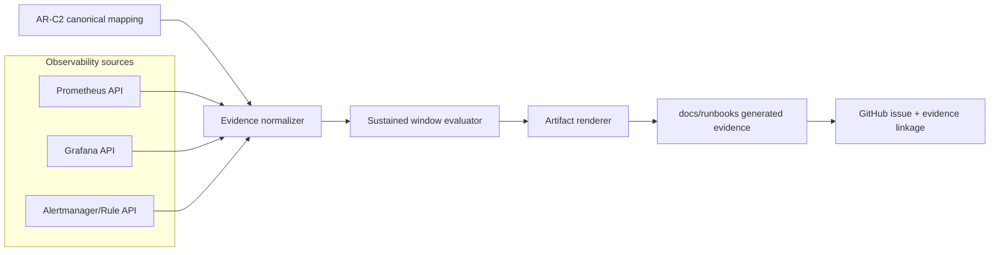
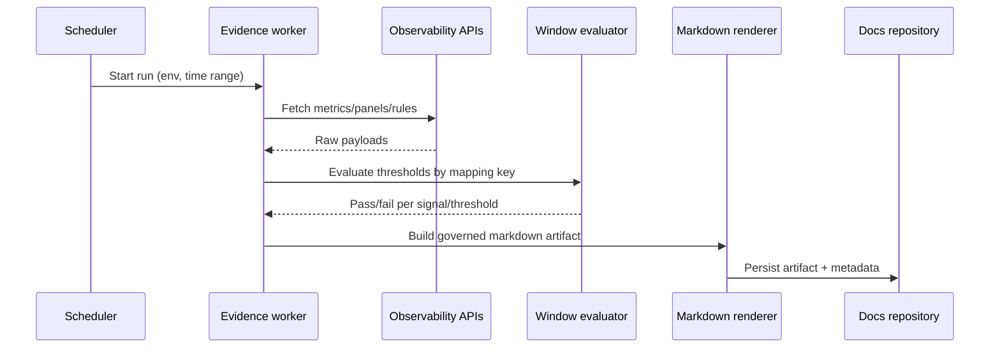
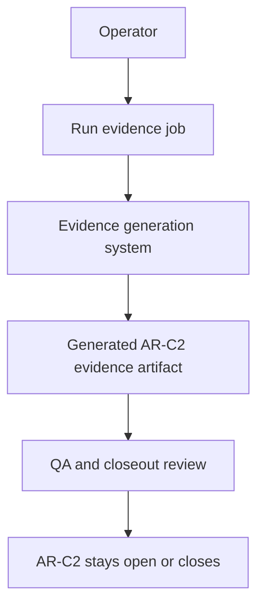
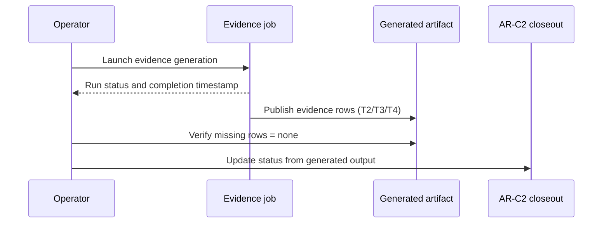

# AR-C2 Automated Evidence Technical Manual

This manual defines the technical architecture for automatic AR-C2 evidence
generation.

## Context

AR-C2 has canonical SLA and mapping artifacts, but technical closure still
depends on manual extraction from monitoring tools.

The missing capability is an automated collector and renderer pipeline that
produces governed evidence artifacts directly from source systems.

## Objective

Define a deterministic technical architecture that:

- collects AR-C2 observability signals and rule metadata,
- evaluates sustained threshold windows,
- renders a governed artifact consumable by the governing GitHub issue.

## Technical scope

- collector for metrics, dashboard metadata, and alert metadata,
- threshold evaluator across sustained windows,
- deterministic artifact generator for governed docs integration.

## Domain architecture



## Runtime sequence



## Data contract (minimum)

- `signal_key`
- `dashboard_ref`
- `panel_key`
- `alert_rule_id`
- `severity`
- `routing_target`
- `window_start_utc`
- `window_end_utc`
- `threshold_result`

## Collector command and inputs

Execution command:

```bash
pnpm ops:ar-c2:evidence
```

Supported input env vars:

- `AR_C2_EVIDENCE_OUTPUT_PATH` (optional output markdown path)
- `AR_C2_DASHBOARD_SNAPSHOT_FILE` (optional JSON file with `panelKeys`)
- `AR_C2_ALERT_SNAPSHOT_FILE` (optional JSON file with `rules[]`)
- `AR_C2_METRICS_SNAPSHOT_FILE` (optional JSON file with `windows[]`)

For duplicate `signal_key` rows (for example stale ratio and unknown ratio that
share the same source metric key), provide distinct `windows[]` entries with
different `expected` values so T4 rows can be resolved independently.

## Invariants

1. Generated artifact must be reproducible from same input window.
2. `signal_key` must exist in canonical AR-C2 mapping.
3. No closure when any required row is missing.
4. Timestamps must be UTC and immutable.
5. Evidence run must report collection gaps explicitly.

## Failure modes

- missing API credentials -> artifact marked `incomplete`.
- missing dashboard panel -> row status `missing_panel`.
- missing alert rule -> row status `missing_alert`.
- insufficient time-series data -> row status `insufficient_window_data`.

## Validation gates

- `pnpm docs:sync`
- `pnpm qa:artifact:check`
- `pnpm verify:prepush`

## References

- [AR-C2 SLA Signal Threshold Mapping](../runbooks/ar-c2-sla-signal-threshold-mapping-20260404.md)
- [AR-C2 SLA operational closure checklist](../planning/closeouts/20260404-ar-c2-sla-operational-closure-closeout.md)

<a id="section-ar-c2-automated-evidence-user-manual-20260404"></a>

## AR-C2 Automated Evidence User Manual

This manual explains how operators use automatic AR-C2 evidence generation.

### Context

Today AR-C2 evidence is partially manual, which delays closure and increases
review friction.

This manual documents the future operating mode where the system generates the
evidence artifact directly from observability sources.

### Objective

Enable operators to run one process that produces complete AR-C2 evidence for
dashboard wiring, alert wiring, and sustained validation windows.

### Who is this for

- on-call operators
- product owners validating SLA posture
- QA reviewers checking closure readiness

### Domain view



### Sequence of use



### User procedure

1. Launch the evidence-generation run for target environment and window.
2. Wait until status is `completed`.
3. Open generated artifact and confirm:
   - dashboard matrix filled,
   - alert matrix filled,
   - sustained window results present.
4. If any row is missing, keep AR-C2 open and create follow-up issue.
5. If all rows are present and pass, proceed to AR-C2 closure review.

Command:

```bash
pnpm ops:ar-c2:evidence
```

### Expected output fields

- environment
- execution timestamp (UTC)
- dashboard panel reference (immutable)
- alert rule reference (immutable)
- threshold window result
- reviewer notes

### References

- [AR-C2 Dashboard And Alert Wiring Evidence](../runbooks/ar-c2-dashboard-alert-wiring-evidence-20260404.md)

> Section status: Active. Owner: Product / Operations / Docs. Colocation does not merge component responsibilities.
