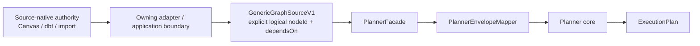
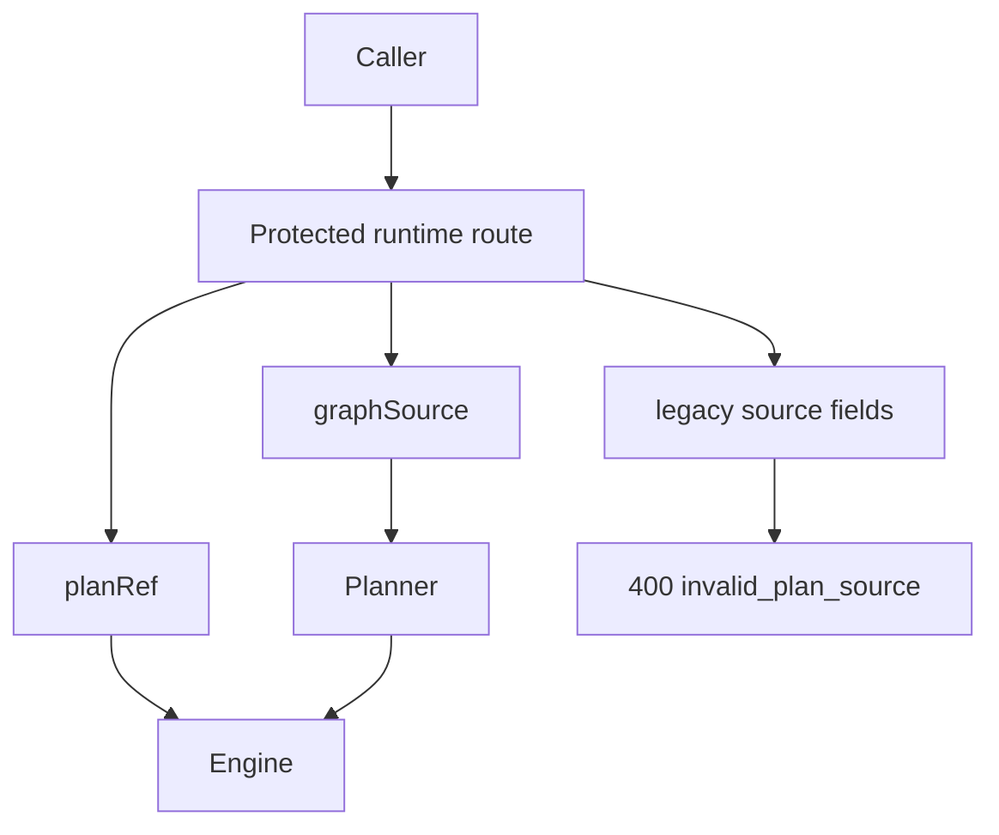
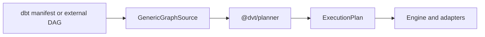
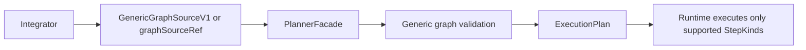

---
title: GenericGraphSource Technical Manual
status: Active
owner: Planning Domain / Architecture / API
last_reviewed: 2026-09-05
---

# GenericGraphSource Technical Manual

## Purpose

`GenericGraphSourceV1` is the canonical typed graph ingress for Planner.
Source-native syntax and artifacts are translated before this boundary. Planner
owns deterministic graph validation, selection and execution-plan materialization;
it does not own source parsing or logical-identity allocation.

This page supersedes the old MW-A2 target wording that described a retained
manifest-normalization utility inside `@dvt/planner`.

## Governing sources

- `AGENTS.md`
- `docs/adr/ADR-0034-bounded-context-boundaries-and-communication-rules.md`
- `docs/adr/ADR-0035-planner-public-contract-evolution-protocol.md`
- `docs/adr/ADR-0064-substrait-semantic-reference-and-bounded-logical-profile.md`
- `docs/architecture/domain-planning.md`
- `docs/planning/proposals/mandatory/runtime-and-contracts/gh-2904-stable-logical-physical-binding-hardcut-20260905.md`

## Current architecture



The adapter boundary may consume external dbt artifacts, provider catalogs or
Canvas state. It must emit an already-governed graph. Planner never falls back
to dbt manifest keys, names, paths, provider coordinates, ordinals or aliases to
manufacture missing logical identity.

## Canonical contract model

The planner contract remains:

```ts
export interface GenericGraphSourceV1 {
  kind: 'generic-graph-v1';
  sourceFamily?: string;
  sourceVersion?: string;
  nodes: readonly GenericGraphNodeV1[];
}

export interface GenericGraphNodeV1 {
  nodeId: string;
  stepKind: string;
  dependsOn: readonly string[];
  stepTypeConfig?: Record<string, unknown>;
  metadata?: {
    displayName?: string;
    sourceRef?: string;
    tags?: Record<string, string>;
  };
}
```

The executable schema in `@dvt/contracts` is authoritative if this explanatory
snippet ever drifts.

## Identity versus provenance

| Field                  | Owner                              | Semantics                                               |
| ---------------------- | ---------------------------------- | ------------------------------------------------------- |
| `nodeId`               | authoring/source owner             | logical identity used by dependencies and Planner steps |
| `dependsOn[]`          | authoring/source owner             | references logical `nodeId` values only                 |
| `stepKind`             | source mapping / governed registry | explicit execution responsibility                       |
| `stepTypeConfig`       | step-kind contract                 | typed/configured execution semantics                    |
| `sourceFamily`         | source adapter                     | provenance only                                         |
| `sourceVersion`        | source adapter                     | provenance only                                         |
| `metadata.displayName` | presentation/source adapter        | mutable metadata                                        |
| `metadata.sourceRef`   | source adapter                     | provenance/binding metadata, not logical identity       |
| `metadata.tags`        | source adapter                     | provenance/observability metadata                       |

For DVT-native semantic authoring, ADR-0064 remains stronger and more specific:
Substrait owns relational semantics while the DVT sidecar owns stable
`RelationId` / `FieldId` and provenance bindings. `GenericGraphSource` does not
replace that semantic authority; it is the Planner-facing graph boundary.

## Planner responsibilities

`PlannerFacade` and Planner collaborators:

1. parse/validate the canonical planner envelope;
2. pass `graphSource.nodeId` and `dependsOn` through without reminting identity;
3. reject duplicate nodes, missing dependency targets and cycles;
4. resolve selection and policies deterministically;
5. validate step-kind configuration through the registry;
6. assemble/hash the immutable `ExecutionPlan`.

Planner does **not**:

- parse raw dbt manifests;
- derive DVT node IDs from dbt `unique_id`;
- repair a missing ID from a display name, path or ordinal;
- query provider catalogs to recover identity;
- persist authoring identity;
- create a second relational IR.

## Source-adapter responsibilities

An owning source adapter/application boundary must:

1. validate the source-native representation;
2. resolve/preserve the source's governed logical identity according to that
   source's authority contract;
3. map dependencies to explicit logical IDs;
4. map source-native node kinds to governed `stepKind` values;
5. retain external/source-native identifiers as provenance when required for
   round-trip or binding, not as an implicit DVT identity fallback;
6. emit `GenericGraphSourceV1` before calling Planner.

A dbt source adapter may therefore retain dbt `unique_id` for dbt authority and
round-trip, while DVT-native logical identity remains independently governed.
The removed `derivePlannerGraphSourceFromManifest()` bridge is not a supported
compatibility path.

## Determinism

Plan identity follows the existing Planner hash contract. `sourceFamily`,
`sourceVersion` and node metadata are provenance-only and do not affect
`inputHashSha256` / `planId`; logical `nodeId`, dependency topology, step
semantics, selection and policies do.

Consequences:

- renaming display metadata does not change plan identity when logical IDs and
  semantics are unchanged;
- moving a physical binding/path does not change dependency identity;
- changing a logical `nodeId` is a semantic graph change;
- node/dependency array ordering is normalized deterministically.

## Fail-closed invariants

- `INV-GGS-001`: `GenericGraphSource` is the only Planner graph ingress.
- `INV-GGS-002`: every `nodeId` is explicit and unique.
- `INV-GGS-003`: every `dependsOn` target resolves to an explicit node in the
  admitted graph.
- `INV-GGS-004`: dependency cycles reject before plan assembly.
- `INV-GGS-005`: Planner never derives or repairs identity from metadata,
  manifest keys, names, paths, providers or ordinals.
- `INV-GGS-006`: provenance-only changes do not mutate plan identity.
- `INV-GGS-007`: source-native adapters remain outside `@dvt/planner`.
- `INV-GGS-008`: no compatibility alias or second graph ingress is retained for
  the removed dbt-manifest bridge.

## Verification

Focused gates for this boundary:

```bash
pnpm --filter @dvt/contracts test
pnpm --filter @dvt/contracts typecheck
pnpm --filter @dvt/planner test
pnpm --filter @dvt/planner typecheck
pnpm --filter dvt-api test
pnpm --filter dvt-api typecheck
GIT_BASE=origin/main GIT_HEAD=HEAD node tools/ci/arc-check.mjs
pnpm verify:prepush
```

Required negative proofs include duplicate logical IDs, unknown dependency
references, cycles, invalid step kinds/config, unresolved execution bindings and
absence of the retired manifest identity bridge from current source/public
exports.

## Historical note

The 2026-04 MW-A2 plans and closeouts are historical evidence for the migration
toward a generic planner source. They must not be read as permission to restore
the temporary `ManifestGraphDeriver` compatibility path after GH-2904.

<a id="section-planner-ingress-hard-cut-user-stories"></a>

## Planner Ingress Hard-Cut User Stories

### User Stories

#### US-PLANNER-HC-001: Start Run Uses Canonical Graph Source

As an API caller starting a planner-backed run, I want to provide `graphSource`
so the runtime planner boundary receives one canonical source shape.

Acceptance:

- `graphSource` is accepted when `planRef` is absent.
- `manifestRef`, raw `manifest`, and raw `nodes` are rejected.
- Invalid source shape returns `400 invalid_plan_source`.

#### US-PLANNER-HC-002: Preview Uses The Same Source Policy

As an API caller previewing a plan, I want preview to reject the same legacy
source fields as start-run so route behavior does not diverge.

Acceptance:

- Preview accepts `graphSource` with a valid `previewProfile`.
- Preview rejects `manifestRef`.
- Preview does not invoke the planner after source-policy rejection.

#### US-PLANNER-HC-003: Persisted Plan And Planner-Backed Branches Do Not Mix

As a runtime operator, I want `planRef` requests and planner-backed requests to
be mutually exclusive so execution cannot combine stale stored-plan identity
with new planner input.

Acceptance:

- `planRef` with planner metadata returns `400 conflicting_plan_inputs`.
- `planRef` with `graphSource` returns `400 conflicting_plan_inputs`.

#### US-PLANNER-HC-004: Dead Compatibility Fields Are Rejected

As an architecture reviewer, I want `targetProfile` to remain out of protected
runtime planner input unless it owns a real decision path.

Acceptance:

- `targetProfile` under planner environment is rejected.
- The component doc keeps `targetProfile` listed as forbidden runtime input.

#### US-PLANNER-HC-005: Future Manifest-Native Ingestion Is Separate

As a product owner, I want any future manifest-native ingestion to be designed
as its own command/query rail so protected runtime remains canonical.

Acceptance:

- Runtime hard-cut docs state that manifest-native ingestion must translate to
  `graphSource` before protected runtime admission.
- No runtime route silently repairs legacy source payloads.

### Scenario Map



> Acceptance scope status: Active. Owner: Architecture / API.

<a id="section-generic-graph-source-user-manual-20260404"></a>

## GenericGraphSource User Manual

### Audience

This guide is for integrators, platform engineers, and API callers who need to
prepare planning inputs without treating dbt manifest format as the only way to
describe a workflow DAG.

### What GenericGraphSource is

`GenericGraphSource` is the target planner-facing model for a normalized
workflow graph.

It answers one question only:

> What nodes exist, what depends on what, and what step kind does each node
> represent?

It is not a runtime worker contract, not a provider adapter contract, and not a
secret payload container.

### Delivery policy for this arc

This arc is delivered in two explicit stages:

1. documentation gate (manuals + target model + invariants)
2. TDD implementation waves (`MW-A2-B` to `MW-A2-E`)

No implementation wave is considered valid if it is not traceable to the
accepted documentation gate.

### Current implementation note

As of `2026-04-10`, the protected runtime hard-cut planner-backed ingress to
canonical `graphSource`.

That means:

- inline `graphSource` is the only active planner-backed runtime input
- legacy `manifestRef` is not accepted by `POST /runs/start` or
  `POST /plans/preview`
- source-native adaptation such as dbt manifest parsing must happen before the
  planner/runtime boundary

### What path to use

#### Current supported input policy (implemented)

The currently implemented public planner-source paths are:

| Path                                                   | Use when                             | Notes                           |
| ------------------------------------------------------ | ------------------------------------ | ------------------------------- |
| inline `graphSource` with `GenericGraphSourceV1` shape | caller has a normalized workflow DAG | canonical planner-backed source |

Planned but not yet implemented in this arc:

- `graphSourceRef` (immutable generic graph ref path)

### Mental model



### As-is vs to-be flow

#### As-is (current usage)


#### To-be (target usage, planned)



The graph source describes planning intent. Execution still depends on runtime
support for the step kinds used by that graph.

### Authoring checklist

1. Give every node a stable `nodeId`.
2. Declare every dependency explicitly in `dependsOn`.
3. Use a real `stepKind` for each node.
4. Keep `stepTypeConfig` focused on step configuration, not secrets.
5. Keep runtime-only worker details out of the graph source.
6. Treat array order as cosmetic. The planner decides deterministic order.

If your source of truth starts from richer domain nodes, normalize those nodes
into explicit `stepKind` values before calling the planner. Do not make
planner-facing `stepKind` depend on ad hoc metadata keys.

### Target shape

The target authoring model is:

```json
{
  "kind": "generic-graph-v1",
  "sourceFamily": "custom-api",
  "sourceVersion": "1.0",
  "nodes": [
    {
      "nodeId": "extract.iot-readings",
      "stepKind": "API_CALL",
      "dependsOn": [],
      "stepTypeConfig": {
        "operationRef": "artifacts://operations/iot-readings.json"
      }
    },
    {
      "nodeId": "warehouse.refresh-proc",
      "stepKind": "DB_PROC_EXEC",
      "dependsOn": ["extract.iot-readings"],
      "stepTypeConfig": {
        "procedureRef": "artifacts://sql/refresh_proc.sql"
      }
    }
  ]
}
```

### Example 1: dbt source through graph-source adapter

If your source of truth is dbt, convert it through the dbt source adapter and
submit the resulting generic graph source.

### Example 2: mixed plan target

Mixed plans are valid at the model layer.

```json
{
  "graphSource": {
    "kind": "generic-graph-v1",
    "sourceFamily": "integration-suite",
    "sourceVersion": "1.0",
    "nodes": [
      {
        "nodeId": "dbt.model.orders",
        "stepKind": "DBT_MODEL",
        "dependsOn": [],
        "stepTypeConfig": {
          "uniqueId": "model.analytics.orders"
        }
      },
      {
        "nodeId": "notify.billing",
        "stepKind": "EMAIL_SEND",
        "dependsOn": ["dbt.model.orders"],
        "stepTypeConfig": {
          "templateRef": "artifacts://mail/orders-ready.json"
        }
      }
    ]
  },
  "selection": {
    "selectedNodeIds": ["notify.billing"],
    "includeUpstream": true
  }
}
```

Important: this example describes the target planner contract. Runtime
execution for non-dbt kinds still depends on later registry and dispatcher
work.

### What the planner validates

#### Current boundary behavior

The planner boundary currently rejects:

- requests with no active source
- requests with more than one active source
- malformed `graphSource` payloads

Graph-level checks such as duplicate ids, missing dependencies, and cycle
validation happen after source normalization in the planner pipeline.

#### Target boundary behavior (MW-A2)

After `MW-A2-B/C/D`, the boundary should also reject:

- malformed `graphSourceRef`
- generic graph sources with duplicate node ids
- generic graph sources with missing dependency targets
- generic graph sources with cycles
- generic nodes that cannot be translated into planner steps

### What the planner does not promise

The planner does not promise:

- runtime executability for every documented step kind
- provider-specific retry or timeout behavior
- secret distribution through `stepTypeConfig`
- worker routing decisions

Those concerns belong to later slices and other bounded contexts.

### Common failures

#### `more than one active source`

You sent more than one active planner source (for example inline
`graphSource` and a forbidden legacy key such as `manifestRef`).

#### `missing dependency target`

A node depends on another node id that is not present in the same graph.

#### `unsupported step kind`

The graph describes a step kind that the planner or runtime has not registered
yet.

#### `invalid step config`

The graph uses a known `stepKind`, but `stepTypeConfig` does not match that
kind's schema.

#### `legacy planner source rejected`

The planner-backed runtime rejects legacy source inputs such as `manifestRef`,
raw `manifest`, or direct `nodes`. Convert those inputs into canonical
`graphSource` before calling the protected runtime.

### Determinism rules for authors

To keep plan identity stable:

1. keep `nodeId` stable across equivalent graphs
2. declare the same dependencies for the same logical workflow
3. do not rely on node array order
4. keep provenance metadata outside the canonical plan core unless the contract
   explicitly says otherwise

### Contributor validation

If you are changing this boundary, use at least:

```bash
pnpm --filter @dvt/contracts test
pnpm --filter @dvt/planner test
pnpm --filter dvt-api test
pnpm verify:prepush
```

### Documentation traceability checklist

Before requesting implementation or review, ensure:

- this user manual and the technical manual are aligned
- as-is/to-be diagrams match the current implementation plan
- invariants and common failures are not contradictory
- every intended behavior change has a corresponding test expectation in the
  technical manual
- wave references (`MW-A2-B`..`MW-A2-E`) stay consistent with the proposal

### Related documents

- [DB-first Component Map](../architecture/component-map.md)

> Section status: Draft. Owner: Planning Domain / API / Docs. Colocation does not merge component responsibilities.
