# Plan Compile Target Architecture Technical Manual

## Purpose

This manual is the target-state technical reference for `MW-D1`.

It defines the architecture that the implementation plan is trying to reach,
without claiming that the current worktree already matches that architecture.
This guide uses `plan compile` as the active ubiquitous language for the
compile-only boundary. Older `MW-D1` proposal and review artifacts may still
say `external compile`; treat that as historical wording, not the active
ownership model.

Use this document when the question is architectural rather than tactical:

- what bounded contexts participate in plan compile
- what the aggregate roots and service roots are
- which ports and adapters are required
- how compile fits into the broader system at C4 level
- how the target compile path should collaborate internally

For durable sequencing, use the [Roadmap Of Record](../planning/roadmap/index.md).
The governing GitHub issue owns delivery status and acceptance.

## Governing sources

- `AGENTS.md`
- `docs/guides/ai-work-protocol.md`
- `docs/adr/ADR-0003-execution-model.md`
- `docs/adr/ADR-0012-plan-integrity-ownership.md`
- `docs/adr/ADR-0034-bounded-context-boundaries-and-communication-rules.md`
- `docs/adr/ADR-0035-planner-public-contract-evolution-protocol.md`
- `docs/architecture/domain-planning.md`
- `docs/architecture/components/api/index.md`
- `docs/guides/plan-compile-target-architecture-technical-manual-20260417.md`

## Scope and non-goals

This manual covers:

- plan compile as a target authoring architecture
- the relationship between compile, preview, and run admission
- target ownership seams for contracts, services, catalogs, and composition
- target diagrams and definitions needed to implement the architecture cleanly

This manual does not claim to define:

- the worker-routing model by queue or image
- provider-specific execution internals
- a new planner contract authority outside `@dvt/contracts`
- a compatibility bridge for preview-era or manifest-era ingress

## Target-state summary

The target architecture is a compile-first plan-compile boundary.

That means:

- callers submit canonical graph definitions through one compile contract
- compile derives `ExecutionPlan` without persistence side effects
- preview and run admission remain downstream concerns
- compile policy is selected from a canonical family and kind catalog
- plugin extensibility is typed and governed, not dynamic and free-form

## C4 Level 1: system context

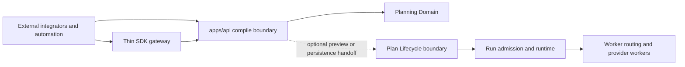

Interpretation:

- plan compile stops at plan derivation
- preview and persistence live in a neighboring lifecycle boundary
- runtime admission and worker routing are later boundaries

## C4 Level 2: container view

```mermaid
flowchart TB
  subgraph Clients["Clients"]
    Direct["Direct API caller"]
    Gateway["SDK client"]
  end

  subgraph Api["apps/api"]
    Http["HTTP transport and auth"]
    CompileApp["Compile application layer"]
    CatalogComp["Catalog and profile composition"]
  end

  subgraph Shared["Shared kernel"]
    Contracts["@dvt/contracts"]
  end

  subgraph Planning["Planning"]
    Planner["@dvt/planner"]
  end

  subgraph Neighbor["Neighboring contexts"]
    Lifecycle["Plan lifecycle"]
    RunAdmission["Run admission"]
  end

  Direct --> Http
  Gateway --> Http
  Http --> CompileApp
  CompileApp --> Planner
  CatalogComp --> Planner
  CompileApp --> Contracts
  CatalogComp --> Contracts
  CompileApp -. no persistence in compile path .-> Lifecycle
  Lifecycle --> RunAdmission
```

## C4 Level 3: component view for plan compile

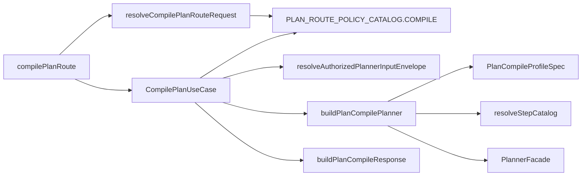

## DDD context map

| Context or governed surface | Kind                             | Responsibility                                                             | Must not own                                   |
| --------------------------- | -------------------------------- | -------------------------------------------------------------------------- | ---------------------------------------------- |
| Plan Compile                | entry/application boundary       | caller-facing compile request and SDK gateway                              | planner internals, persistence, worker routing |
| API Admission               | entry/application boundary       | authn/authz, request parsing, response contract                            | planning semantics                             |
| Planning Domain             | core domain                      | deterministic graph validation and `ExecutionPlan` assembly                | HTTP, persistence, provider lifecycle          |
| Catalog Governance          | shared kernel governed surface   | family and kind definitions, profile-relevant metadata, contribution model | route-local allowlists                         |
| Plan Lifecycle              | neighboring supporting context   | preview persistence, executability validation, `planRef` import            | plan compile authoring                         |
| Runtime Admission           | neighboring application boundary | `targetAdapter` choice, run preconditions, execution start                 | compile semantics                              |

## Aggregate roots, logical roots, and service roots

| Root kind                  | Name                                                               | Owner                               | Responsibility                                            | Notes                                                   |
| -------------------------- | ------------------------------------------------------------------ | ----------------------------------- | --------------------------------------------------------- | ------------------------------------------------------- |
| aggregate root             | `ExecutionPlan`                                                    | Planning Domain                     | immutable plan result of compile                          | canonical planning aggregate                            |
| logical catalog root       | `ResolvedStepCatalog`                                              | Catalog Governance plus composition | resolved family and kind inventory for one boundary       | immutable resolved view, not a mutable domain aggregate |
| application service root   | `CompilePlanUseCase`                                               | API application layer               | compile-only orchestration                                | should accept and return plain data                     |
| composition root           | `buildProtectedRuntimeModule` and compile-specific planner builder | `apps/api`                          | bind ports, policies, planner configuration, and adapters | root of runtime composition                             |
| neighboring aggregate root | `Run`                                                              | Runtime domain                      | execution lifecycle after compile                         | outside `MW-D1`, included for boundary clarity          |

## Ports and adapters inventory

| Port or seam               | Direction                 | Owner                            | Status in target architecture   | Notes                                                    |
| -------------------------- | ------------------------- | -------------------------------- | ------------------------------- | -------------------------------------------------------- |
| compile transport boundary | inbound                   | `apps/api`                       | explicit route plus SDK gateway | HTTP and SDK are gateways over one contract              |
| authentication port        | inbound dependency        | API admission                    | existing seam                   | current code uses `IAuthenticator`                       |
| authorization service seam | inbound dependency        | API admission                    | existing seam                   | tenant and action scope enforcement                      |
| planner port               | outbound                  | Planning Domain contract surface | existing seam                   | current planner boundary is `PlannerFacade` / `IPlanner` |
| compile profile selector   | outbound composition seam | `apps/api`                       | target seam                     | chooses one `PlanCompileProfileSpec`                     |
| step catalog resolver      | outbound composition seam | `apps/api`                       | target seam                     | resolves built-ins plus approved plugin contributions    |
| plugin contribution loader | outbound composition seam | `apps/api`                       | target seam                     | may load approved contribution packs, not arbitrary code |
| plan lifecycle boundary    | neighboring outbound seam | Plan Lifecycle                   | out of compile path             | preview/import use it, compile does not                  |
| run admission boundary     | neighboring outbound seam | Runtime Admission                | out of compile path             | start-run owns `targetAdapter`                           |

## Target module and package ownership map

| Target module or package seam                  | Proposed home                        | Responsibility                                             | Must not own                            |
| ---------------------------------------------- | ------------------------------------ | ---------------------------------------------------------- | --------------------------------------- |
| plan compile request and response contract     | `packages/@dvt/contracts`            | caller-visible DTOs and validation semantics               | route policy or runtime composition     |
| compile route and route contract parser        | `apps/api` HTTP entrypoint layer     | transport parsing, auth handoff, response status mapping   | planner orchestration or catalog policy |
| compile application service                    | `apps/api` application layer         | compile-only orchestration over plain data                 | HTTP concerns or persistence lifecycle  |
| plan-route policy catalog                      | `apps/api` application support layer | route action metadata plus planner-input enrichment policy | planner behavior or HTTP response text  |
| authorized planner-input assembler             | `apps/api` application support layer | canonical input assembly for planner-backed plan routes    | auth policy ownership or route parsing  |
| compile profile selector                       | `apps/api` composition root          | choose one typed boundary policy                           | route-local literals                    |
| step catalog resolver                          | `apps/api` composition root          | merge built-ins plus approved plugin contributions         | mutable runtime registry semantics      |
| planner facade and deterministic plan assembly | `@dvt/planner`                       | graph validation and `ExecutionPlan` derivation            | HTTP or persistence concerns            |
| preview and persistence services               | Plan Lifecycle boundary              | persistence, executability validation, `planRef` lifecycle | compile-only authoring semantics        |
| run-admission services                         | Runtime Admission boundary           | `targetAdapter` choice and run-start preconditions         | compile boundary policy                 |

Interpretation:

- this map is the target code shape, not proof that every file already exists
- the route owns transport truth
- the use case owns compile orchestration truth
- the composition root owns catalog and profile truth
- the planner owns deterministic plan derivation truth

## Port contracts and primary interactions

| Port or contract                     | Primary caller                 | Primary callee                   | Data crossing the seam                            | Invariant                                                      |
| ------------------------------------ | ------------------------------ | -------------------------------- | ------------------------------------------------- | -------------------------------------------------------------- |
| `PlanCompileRequestV1`               | external caller or SDK         | compile route                    | graph source, selection, execution scope context  | compile request stays generic and non-dbt-first                |
| auth and authorization seam          | compile route                  | authentication and RBAC services | principal plus tenant or project scope            | compile never bypasses protected runtime scope                 |
| compile application service boundary | compile route                  | `CompilePlanUseCase`             | parsed request plus authorized scope              | orchestration remains transport-agnostic                       |
| planner ingress envelope seam        | compile application service    | planner facade                   | route-policy-selected canonical planner envelope  | compile uses one planner model only                            |
| catalog resolution seam              | compile composition root       | catalog resolver                 | built-ins, approved plugin packs, compile profile | unknown families and kinds fail closed                         |
| compile response contract            | compile presenter              | external caller or SDK           | `ExecutionPlan` plus compile metadata             | response never implies persistence or executability validation |
| preview lifecycle seam               | client or neighboring boundary | plan lifecycle services          | optional persisted plan request                   | compile does not cross this seam implicitly                    |
| start-run seam                       | client or neighboring boundary | runtime admission                | `planRef`, `targetAdapter`, run intent            | provider selection stays outside compile                       |

Observability note:

- compile request observability supports extension keys
- the shared authorized planner-input assembler must preserve extension keys
  instead of narrowing to a fixed field subset

## Domain and class relationship view

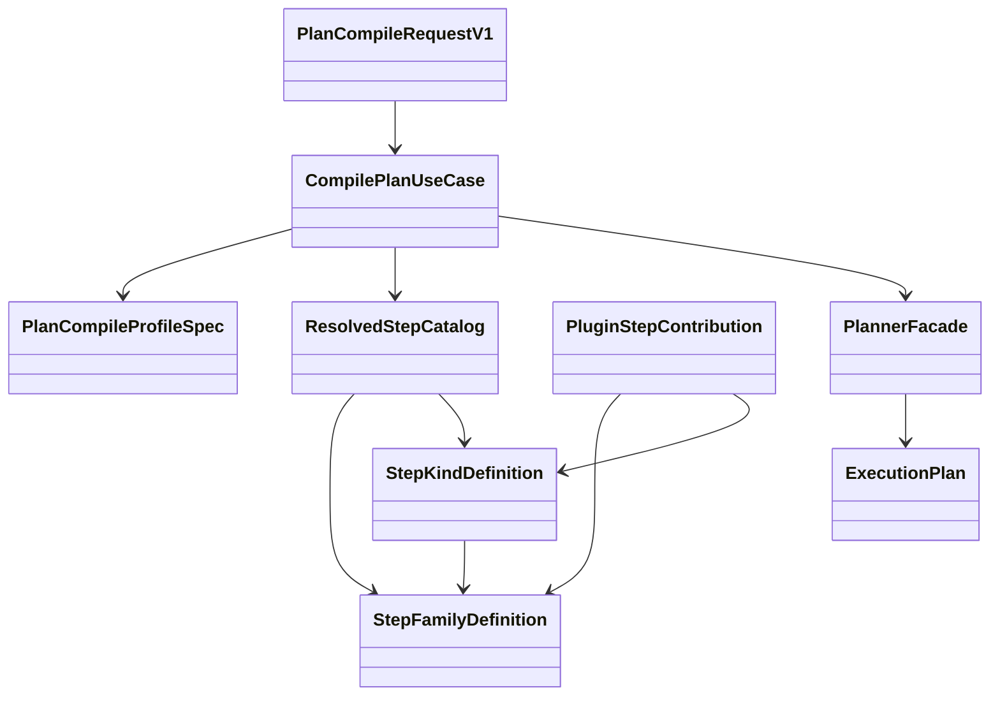

## Sequence: plan compile happy path

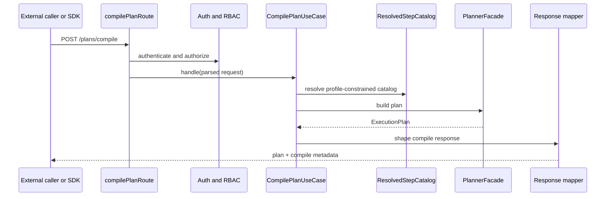

## Sequence: add a new family and expose it

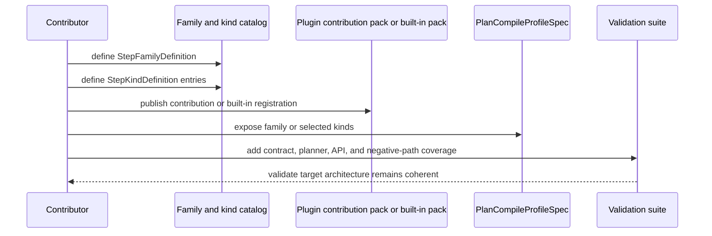

## Sequence: compile-to-run handoff

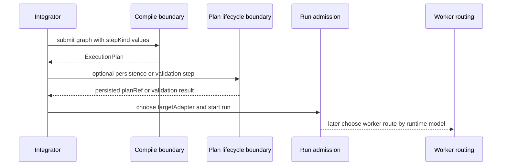

Interpretation:

- compile owns authoring and derivation
- preview owns lifecycle and persistence
- run admission owns provider selection
- worker routing is a later concern owned by `MW-D2`

## Domain glossary

| Term                       | Meaning in `MW-D1`                                                    | Notes                                                                      |
| -------------------------- | --------------------------------------------------------------------- | -------------------------------------------------------------------------- |
| plan compile boundary      | the caller-facing compile-only API or SDK gateway                     | the first product-facing authoring seam                                    |
| `ExecutionPlan`            | immutable compile result                                              | canonical planning aggregate                                               |
| `ResolvedStepCatalog`      | immutable resolved family and kind inventory for one boundary         | composition-owned view, not a mutable route registry                       |
| `PlanCompileProfileSpec`   | typed policy selection for one compile boundary                       | selects from the resolved catalog only                                     |
| `PluginStepContribution`   | typed plugin-owned contribution pack                                  | contributes families or kinds without becoming a second contract authority |
| Plan Lifecycle boundary    | neighboring context for preview, persistence, and `planRef` lifecycle | outside compile-only flow                                                  |
| Runtime Admission boundary | neighboring context for start-run and provider choice                 | owns `targetAdapter`                                                       |
| worker routing             | later execution-routing concern by queue, image, or worker role       | explicitly deferred to `MW-D2`                                             |

## Architecture invariants

- plan compile must remain compile-only
- compile policy must come from a canonical catalog or approved contribution
  pack
- compile planner registry must be fail-closed to profile-selected
  `allowedStepKinds`
- step-family semantics must not be inferred from naming conventions
- route modules must not become the home of planner policy
- free-form JSON must not become the authority for schemas or handlers
- worker routing must remain outside `MW-D1`

## Relationship to the extension guide

Use this manual for:

- target architecture reading
- ports, roots, aggregates, and C4 views
- compile-to-runtime boundary clarity

Use
[Plan compile catalog extension technical manual](plan-compile-target-architecture-technical-manual-20260417.md#section-plan-compile-catalog-extension-technical-manual-20260417)
for:

- how to add a new family or kind
- how to package plugin contributions
- how to update compile profiles safely

<a id="section-plan-compile-catalog-extension-technical-manual-20260417"></a>

## Plan Compile Catalog Extension Technical Manual

### Purpose

This manual defines the target-state technical model for extending the plan
compile boundary with new step families, new step kinds, and plugin-backed
catalog contributions.
This guide uses `plan compile` as the active ubiquitous language for the
compile-only boundary. Older `MW-D1` proposal and review artifacts may still
say `external compile`; treat that as historical wording, not the active
ownership model.

Temporal is the only implemented workflow provider. A future provider requires
an ADR, a real adapter, capability conformance, production composition, and
documentation evidence before it can become an active `targetAdapter`.

Use this guide when the change affects any of the following:

- the canonical family taxonomy
- the canonical step-kind catalog
- the plan compile profile
- plugin-owned step-family or step-kind contributions

This guide complements
[How To Add A New StepKind](how-to-add-step-kind-20260406.md). That guide
remains the focused protocol for adding a new kind. This manual explains the
broader family and catalog model that the new kind must fit into.

For C4, DDD, ports, roots, aggregates, and target compile-path architecture,
use
[Plan Compile Target Architecture Technical Manual](plan-compile-target-architecture-technical-manual-20260417.md).

### Governing sources

- `AGENTS.md`
- `docs/guides/ai-work-protocol.md`
- `docs/adr/ADR-0034-bounded-context-boundaries-and-communication-rules.md`
- `docs/adr/ADR-0035-planner-public-contract-evolution-protocol.md`
- `docs/guides/how-to-add-step-kind-20260406.md`

### Target-state note

This is a target-state manual for `MW-D1`.

Parts of the catalog and plugin model are still a design target rather than
fully shipped code. Treat this document as the canonical extension design for
new family work. Do not treat it as proof that every mechanism described here
already exists in production code.

### Design goals

- fail closed for unknown families and step kinds
- group step kinds by explicit family instead of naming convention
- keep one contract authority for plan compile
- allow plugin contribution without allowing arbitrary runtime-local strings
- keep schemas, validators, and handlers in code, not in free-form JSON

### Canonical objects

| Object                   | Responsibility                                                             | Proposed owner                                        | Must not become                                             |
| ------------------------ | -------------------------------------------------------------------------- | ----------------------------------------------------- | ----------------------------------------------------------- |
| `StepFamilyDefinition`   | declare canonical family identity, owner, and extension policy             | `@dvt/contracts` or approved plugin contribution pack | an implicit naming convention                               |
| `StepKindDefinition`     | declare canonical step kind, family, schema, and execution profile         | `@dvt/contracts` or approved plugin contribution pack | a route-local `kind -> schema` map                          |
| `PluginStepContribution` | contribute plugin-owned families and step kinds through one typed contract | plugin package using the shared contribution contract | a second contract authority or dynamic runtime escape hatch |
| `ResolvedStepCatalog`    | represent the merged, validated catalog used by compile composition        | `apps/api` composition root                           | an ad hoc mutable registry                                  |
| `PlanCompileProfileSpec` | declare which families and kinds one compile boundary exposes              | `apps/api` composition root                           | free-form JSON with embedded schemas or handlers            |
| `CompilePlanUseCase`     | orchestrate compile-only behavior once the planner is built                | `apps/api` application layer                          | a config-driven behavior script                             |

### Ownership line

| Concern                     | Form                     | Owner                             | Rule                                                        |
| --------------------------- | ------------------------ | --------------------------------- | ----------------------------------------------------------- |
| request and response shape  | contract                 | `@dvt/contracts`                  | caller-visible semantics live here                          |
| compile-only orchestration  | code                     | `apps/api` application service    | behavior stays in code                                      |
| family and kind definitions | governed catalog entries | contracts or approved plugin pack | definitions stay typed and reviewable                       |
| boundary selection policy   | typed profile spec       | `apps/api` composition root       | policy is typed configuration, not transport logic          |
| deploy-time enablement      | config                   | environment or host config        | config may choose predeclared profiles or plugin packs only |

### Semantic axes

Multi-workflow design stays coherent only if these decisions remain separate.

| Axis            | Meaning                                  | Decided by                            | Example                                                  | Must not be confused with |
| --------------- | ---------------------------------------- | ------------------------------------- | -------------------------------------------------------- | ------------------------- |
| `stepKind`      | semantic meaning of one node             | graph contract plus canonical catalog | `DBT_MODEL`, `LOAD_OBJECT_FILE_TO_POSTGRES`, `SPARK_JOB` | runtime provider          |
| `family`        | taxonomy grouping for step kinds         | canonical catalog                     | `dbt`, `object_file_load`, `spark`                       | handler implementation    |
| `targetAdapter` | runtime provider selected for start-run  | run admission contract                | `temporal`                                               | node semantics            |
| `workerRoute`   | deployment or task-queue destination     | runtime routing model                 | `dbt-worker`, `spark-worker`                             | compile policy            |
| `pluginPack`    | source of contributed families and kinds | approved plugin contribution pack     | `acme-spark-plugin`                                      | contract authority        |

Working rule:

- use `stepKind` to say what the node is
- use `family` to group related kinds
- use `targetAdapter` to say where the run is orchestrated
- use `workerRoute` later to say where the step is executed

`workerRoute` belongs to `MW-D2`, not to the compile contract.

### Object relationship diagram

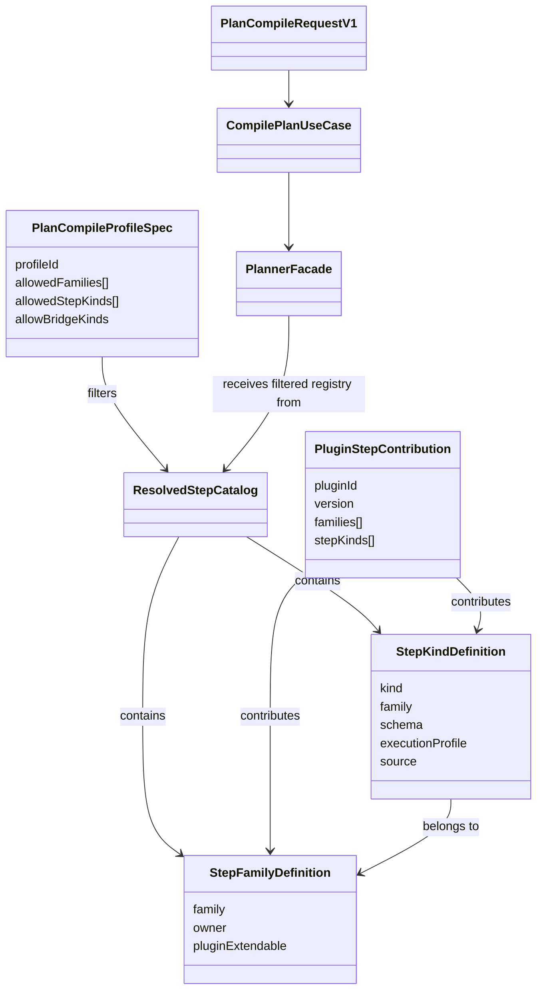

### Sequence: resolve the compile catalog

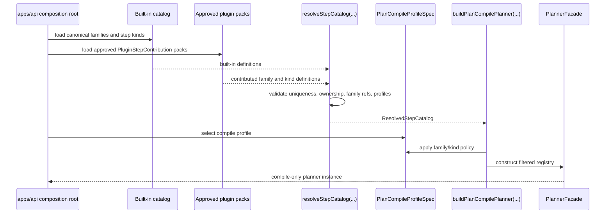

### Sequence: semantic decisions across compile and run

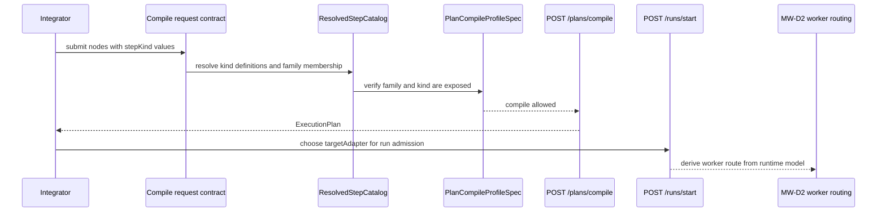

This is the key distinction:

- compile determines whether the graph is accepted as a definition
- start-run determines which runtime provider is selected
- runtime routing later determines which worker image or task queue executes the step

### Sequence: add a new family

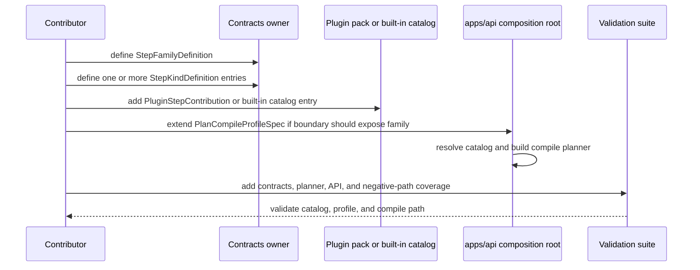

### Extension protocol

#### 1. Decide the extension type

Choose one path first:

- new step kind in an existing family
- new family with one or more new step kinds
- plugin-owned contribution to an existing or new family
- compile profile change only, with no new family or kind

Do not start by editing route code or inline allowlists.

#### 2. Define or select the family

For an existing family:

- reference the canonical `family` id explicitly from the new kind

For a new family:

- create one `StepFamilyDefinition`
- declare owner, description, and whether plugin extension is allowed
- keep the family id stable and reviewable

Every step kind must belong to exactly one family.

#### 3. Define the step kinds

For each new kind:

- create one `StepKindDefinition`
- reference the owning family explicitly
- attach schema validation
- attach execution profile metadata
- declare whether the source is built-in or plugin-contributed

Do not infer family membership from naming.

#### 4. Package the contribution

For built-ins:

- place the family and kind definitions in the canonical built-in catalog

For plugin-owned contributions:

- publish one typed `PluginStepContribution`
- keep the contribution pack declarative
- expose family and kind definitions through the shared contract shape

Do not let plugins register arbitrary runtime strings outside the contribution
contract.

#### 5. Resolve the catalog in composition

The application composition root must:

- load the built-in catalog
- load approved plugin contribution packs
- resolve them into one `ResolvedStepCatalog`
- reject duplicate families, duplicate kinds, orphan kinds, or incomplete
  execution profiles

The resolved catalog is the only catalog the plan compile planner may use.

#### 6. Extend the compile profile

If the plan compile boundary should expose the new family or kind:

- update `PlanCompileProfileSpec`
- prefer family-level selection when the whole family is intended
- use kind-level selection only when the boundary intentionally exposes a subset

The compile profile is the policy seam. The route and use case must not carry
raw policy literals.

Implementation rule:

- build the compile planner registry from `allowedStepKinds` only
- do not compose plan compile with `createDefaultStepTypeRegistry(...)`
  because that re-introduces unrelated built-in kinds into the boundary

#### 7. Add validation and negative paths

Required coverage:

- family reference is valid
- duplicate family id rejects
- duplicate step kind rejects
- orphan kind rejects
- unsupported adapter profile rejects
- compile profile cannot expose unknown family or kind
- compile route still rejects legacy ingress fields

#### 8. Update documentation and planning

When the slice changes active planning posture:

- update the relevant proposal or closeout
- record status and evidence in the governing GitHub issue
- regenerate planning-derived views
- sync docs indexes

### What may live in configuration

Allowed in typed configuration:

- profile id selection
- allowed family ids
- allowed step kind ids
- enablement of already-approved plugin packs

Not allowed in free-form configuration:

- schema definitions
- step handlers
- planner behavior semantics
- arbitrary new family ids or step kinds
- route-owned allowlists

Put differently:

- contracts define shape
- code defines behavior
- typed profile specs define boundary policy
- config may only enable or disable predeclared policy artifacts

### Observability extension rule

`PlannerObservabilitySchema` is extension-friendly (`catchall`).

Compile envelope mapping therefore must preserve custom observability keys and
must not reduce payloads to only `tags` and `extra`.

### Illustrative typed profile example

Illustrative shape:

```ts
const planCompileProfile: PlanCompileProfileSpec = {
  profileId: 'plan-compile-v1',
  allowedFamilies: ['object_file_load', 'spark'],
  allowedStepKinds: ['LOAD_OBJECT_FILE_TO_POSTGRES', 'SPARK_JOB'],
  allowBridgeKinds: false,
};
```

This is acceptable because it selects from the resolved catalog.

This would not be acceptable if it attempted to embed schema objects, handler
functions, or arbitrary unreviewed family ids directly from free-form config.

### Worked example: distinguish object-file loading from `SPARK_JOB`

- `LOAD_OBJECT_FILE_TO_POSTGRES` and `SPARK_JOB` are different `stepKind`
  values.
- They belong to the `object_file_load` and `spark` families.
- Either kind may still run through the same `targetAdapter`, such as
  `temporal`.
- The worker image or queue may still differ later, which is a routing concern
  owned by `MW-D2`.

So the semantic split is:

- `stepKind` says what the node means
- `family` groups that meaning
- `targetAdapter` says which runtime provider orchestrates the run
- runtime routing says where the step is executed operationally

### Worked example: add a `spark` family

1. Define `StepFamilyDefinition { family: "spark", ... }`.
2. Define `StepKindDefinition` entries such as `SPARK_JOB`.
3. Attach schema and execution profile for `SPARK_JOB`.
4. Add the family and kind through either the built-in catalog or one approved
   `PluginStepContribution`.
5. Extend `PlanCompileProfileSpec` if `/plans/compile` should expose the
   new family.
6. Add contracts, planner, and API negative-path tests.
7. Update planning docs and the closeout for the slice that introduced `spark`.

### Validation baseline

- `pnpm docs:sync`
- `pnpm exec markdownlint-cli2 "docs/guides/plan-compile-target-architecture-technical-manual-20260417.md" --ignore-path .markdownlintignore --config .markdownlint-cli2.jsonc`
- `pnpm --filter @dvt/contracts test`
- `pnpm --filter @dvt/planner test`
- `pnpm --filter dvt-api test`
- `pnpm verify:prepush`

### Rules

- Do not create route-local or adapter-local step-kind allowlists.
- Do not infer family from step-kind naming.
- Do not use free-form JSON as the authority for schemas or handlers.
- Do not let a plugin bypass the canonical catalog model.
- Do not expose a new family on the plan compile boundary without an
  explicit profile update.

> Section status: Active. Owner: Architecture / API / Planner / Runtime. Colocation does not merge component responsibilities.
