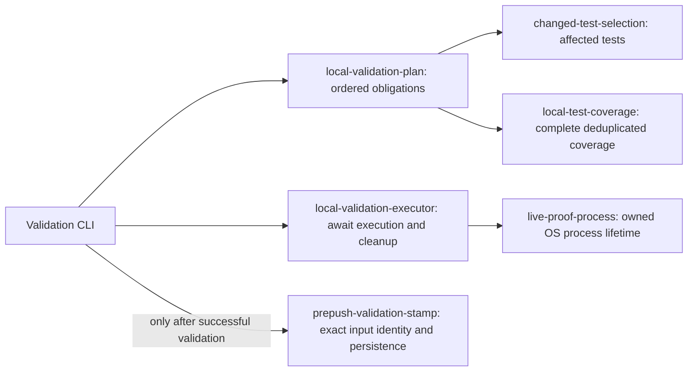
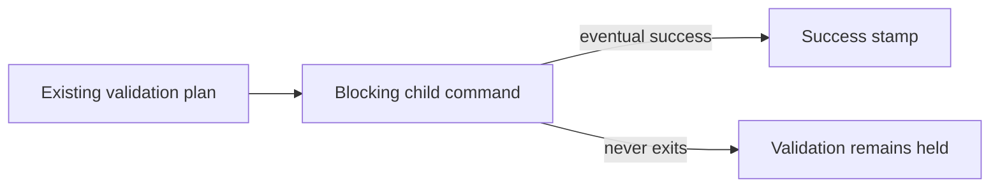
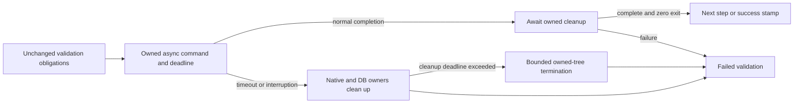

---
title: PR Preflight And CI Triage
status: Active
owner: Product / Architecture / Delivery / Docs
last_reviewed: 2026-09-17
---

# PR Preflight And CI Triage

Operational guide for the path:

`local work -> prepush -> PR -> CI -> green`

Use this guide for implementation slices and PR-green recovery work.

## Governing Baseline

- `AGENTS.md`
- `docs/guides/ai-work-protocol.md`
- `docs/planning/status/governance-document-rule-inventory.md`
- [CI, Prepush & PR Process — Observations and Improvement Log](https://github.com/dunay2/dvt/blob/d3fe40beaa66bd8d98ae9397b76340ff5f895f21/docs/planning/reviews/ci-and-delivery/20260330-ci-prepush-pr-process-observations.md)

## Standard Flow

1. Run local diagnostics and branch hygiene:
   - `powershell -ExecutionPolicy Bypass -File .\scripts\hygiene.ps1 -BaseBranch main`
2. Run slice validations (package-level tests/build/typecheck for touched scope).
3. Run repository gate before push:
   - `pnpm verify:prepush`
   - This is local push readiness: affected checks and complete browser admission,
     including declared native host proof. Common browser scenarios run in the
     required hosted Test Suite. Native/toolchain/unknown inputs retain full
     local proof. Explicit `test:web:changed` still runs both phases.
4. Push and open/update PR.
   - The pre-push hook re-enters `verify:prepush -- --hook`. When the same
     `HEAD` and local changed-file fingerprint already passed the manual gate,
     the hook skips the duplicate changed-slice run. If the tree changed, it
     runs the gate again.
   - Git aliases and their resolved commit SHAs are equivalent inputs only
     within the same validation mode. Explicit `GIT_HEAD` selects snapshot
     semantics in downstream gates; it is not interchangeable with local
     worktree validation. Moved refs, changed content, or unavailable Git
     evidence must not reuse a successful stamp.
5. If CI is red, use log-first triage:
   - extract failed job logs first
   - patch root cause
   - rerun only required checks

For merge acceptance, read the current PR head and draft state from GitHub and
require successful current-candidate required aggregates. Missing, pending,
failed, cancelled, skipped or neutral required results do not establish executed
acceptance. Confirm the expected head again when merging. `pr:checks` is only a
diagnostic: its current empty/all-skipped behavior is not an acceptance receipt.
The strict repository ruleset and the existing Test Suite fan-in remain enabled;
they retain every selected browser partition and scenario.

Only outer `verify:prepush` writes receipt v2 with
`purpose: local-push-readiness`, after all selected checks. Inner
`verify:changed` writes no readiness stamp; a later ADR-0000 failure must leave
no partial-success receipt. Receipts bind the effective host platform; Linux
readiness cannot replace required Windows proof in a shared checkout.
Existing fingerprint and validation-level rules
remain unchanged. Historical v1 or wrong-purpose receipts cannot be reused.

Before merging, run `pnpm docs:feature-mechanization:implementation` against the
existing local Planning DB with explicit `GIT_BASE` and `GIT_HEAD` commit SHAs
and a clean worktree. Record both SHAs, the command and result on the PR. Repeat
when either SHA changes; a cached pre-push stamp is not fresh DB evidence.
Unavailable DB or invalid comparison evidence blocks integration. This
[single-team boundary](../planning/proposals/mandatory/governance-and-docs/feature-mechanization-db-first-read-model-plan-20260605.md#single-team-validation-boundary)
is a local operator obligation, not a check independently enforced by GitHub.

Changes confined to the Test Suite workflow or shared native-browser preparation
action use the [hosted adapter validation boundary](../architecture/components/ci-governance/local-changed-files-gate-component.md#hosted-adapter-validation).
The ordinary local gate retains complete CI contracts and relevant Vitest guards;
the mandatory hosted matrix proves the adapter on its actual platform. Shared,
root-policy or unclassified companions retain the complete local Web command.
This automatic selection does not change the diff, receipt identity or acceptance
requirement. Do not treat a local pass as hosted acceptance or use iteration mode
as a substitute for the gate.

## Conflict Triage And Cleanup Safety

Classify each conflicted file by its current owner and intended change before
choosing either side or resolving it manually. Do not apply a bulk side selection
without checking what it discards. After resolution, scan for conflict markers,
run the affected tests, and follow the commit and validation sequence in
`AGENTS.md` before push.

Branch diagnostics do not authorize deletion. Destructive cleanup remains an
explicit opt-in operation with the confirmation supported by `scripts/hygiene.ps1`;
never infer permission from a branch being reported as superseded.

## First-Red Triage Rule

Do not start by polling loops.

Start with failed-job extraction first, then decide the minimal rerun set.

## Bounded Local Validation Lifetime

The existing `RunChangedSliceVerification` command owns local plan execution;
`verify:prepush` and `ai:preflight` await that same executor. The existing
`RunWebCypressNative` and disposable PostgreSQL proof owners retain resource
cleanup. This change does not select fewer checks or change acceptance evidence.

The validation modules have separate responsibilities. The previous shared plan
module combined selection, composition and execution, while `verify:changed`
imported the pre-push CLI to access its receipt implementation. That dependency
made changes to process containment and receipt identity look like changes to
test routing.

`scripts/lib/local-validation-executor.cjs` receives an already constructed plan
and owns execution budgets, environment isolation, interruption and step results.
It does not select checks or write receipts. `scripts/lib/prepush-validation-stamp.cjs`
owns Git input fingerprints, validation-level matching and receipt persistence;
it does not launch validation. Only outer prepush authorizes persistence after
the entire local plan succeeds. Shared command values and labels belong to
`scripts/lib/local-validation-plan-values.cjs`, not to an executable CLI.
The existing plan and CLI modules do not re-export moved implementations.

Receipt v2 preserves exact Git fingerprints and validation-level matching. Tests
move with their behavior instead of being copied: executor tests exercise process
lifetimes, receipt tests exercise identity and persistence, and CLI tests retain
the awaited-success-before-stamp boundary. The existing `test:verify-prepush`
command continues to cover the separated validation contracts.

The previous execution boundary was synchronous and unbounded:

The executor now awaits owned asynchronous processes. Its initial per-step and
total execution limits are both 120 minutes: the existing pre-push step itself
invokes a complete nested changed-slice plan, so a short leaf-test limit would
incorrectly terminate a valid compound step. These are containment limits, not
performance targets. Nested commands inherit the earlier absolute deadline;
starting another wrapper cannot renew the budget. Output silence is not used as
a timeout signal.

Execution and cleanup have separate bounded lifetimes: an interrupted step has
60 seconds for cooperative cleanup and a further 5 seconds for forced process
retirement. Native browser and LIVE
database owners observe the inherited deadline themselves, including on Windows,
where forced process termination cannot run JavaScript `finally` blocks. The
executor allows cooperative cleanup before its existing process-tree adapter
forces termination. A forced fallback reports resource cleanup as unconfirmed;
it must never claim that a database was disposed merely because a PID exited.
POSIX process groups do not include separately detached descendant groups;
their existing owners must perform and await their own cleanup.

Cypress's module API does not cancel its child process when a caller stops
awaiting its promise. The native runner therefore sets its CLI exit status
without calling `process.exit`: after interrupted preview cleanup, referenced
Cypress processes keep their owning wrapper alive. The bounded parent executor
can still retire that exact process tree. A rejected module promise alone is
not a browser-retirement receipt, and forced retirement remains failed and
unconfirmed for application-resource cleanup. This boundary is exercised with
the actual CLI completion block and a real held module child, not only with a
deferred JavaScript promise.

Each completed step reports its identity, elapsed duration, exit/signal and
outcome. Timeout, cancellation, spawn errors and cleanup failures stop the plan;
a later zero exit during cleanup cannot change an interrupted step to success.
All CLI callers await execution and cleanup before writing a validation stamp.
An incomplete run writes no new success evidence. Validation errors and cleanup
errors remain visible together. Limits and injected signals may be shortened in
focused tests; malformed or unbounded limits fail before spawning a command.

This boundary is tested with deferred completions, timeout/abort races, actual
owned Node child trees, cooperative cleanup and unchanged unrelated processes.
Full native browser/DB acceptance remains a separate required closeout gate.

## Generated Docs Rule In PR Flow

If the slice touches planning/docs structure or workspace structure, run required generators before push:

- `pnpm docs:sync`
- `pnpm docs:status:generate --code-state-only` (DB-free local inventory when
  workspace source sets changed)
- `pnpm docs:publish` only when the PR requires explicit DB-backed publication
  acceptance; never commit the generated publication tree

Then run `pnpm verify:prepush` again.

## RC-C2 Intake Rule (Operational Friction)

When a cycle exposes repeated friction, capture synthesis in canonical review surface:

- [RC-C2 Operational Friction Intake Review](https://github.com/dunay2/dvt/blob/d3fe40beaa66bd8d98ae9397b76340ff5f895f21/docs/planning/reviews/ci-and-delivery/20260402-rc-c2-operational-friction-intake-review.md)

Use local logs only as input material (for example under `tmp/operational-logs/`).
Do not publish local logs directly under canonical `docs/planning/status/`.

## Completion Signal

A cycle is considered clean when:

- preflight ran before push
- `pnpm verify:prepush` passed
- first-red diagnosis used failed-job logs first (if red occurred)
- required planning surfaces were synchronized when applicable
