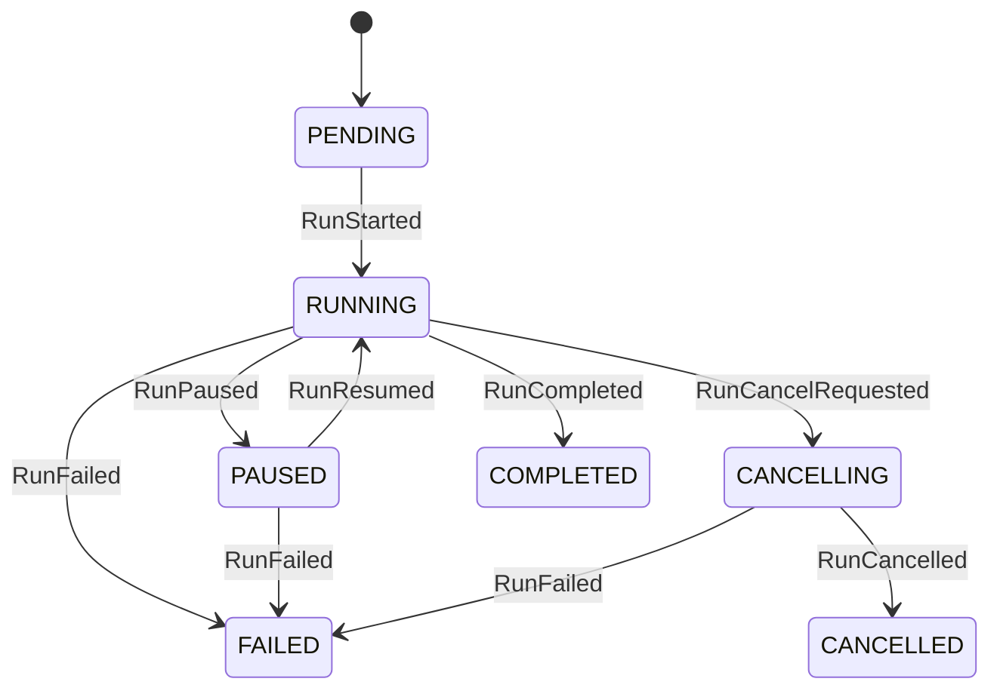
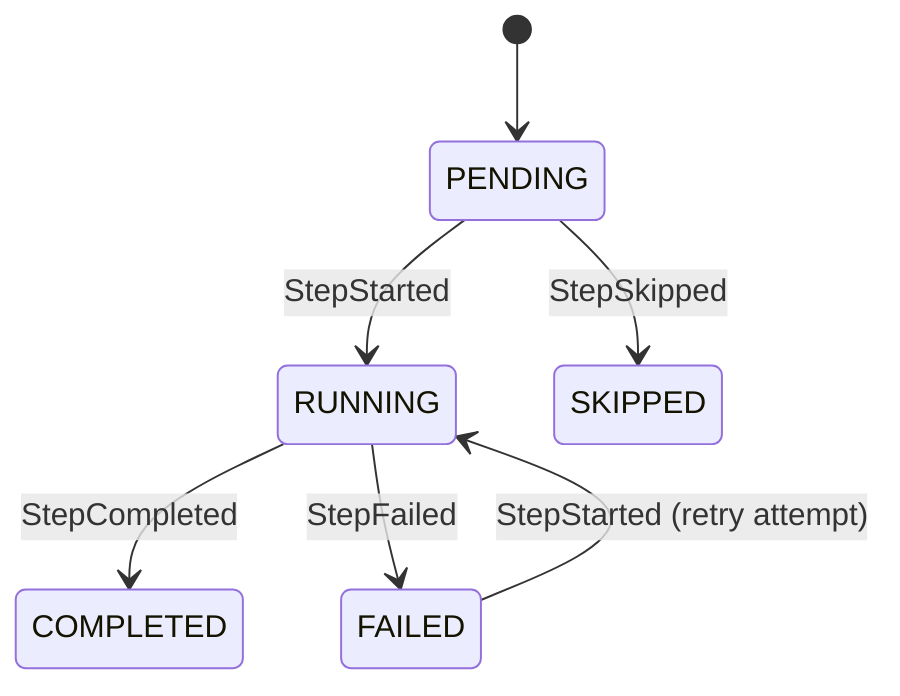
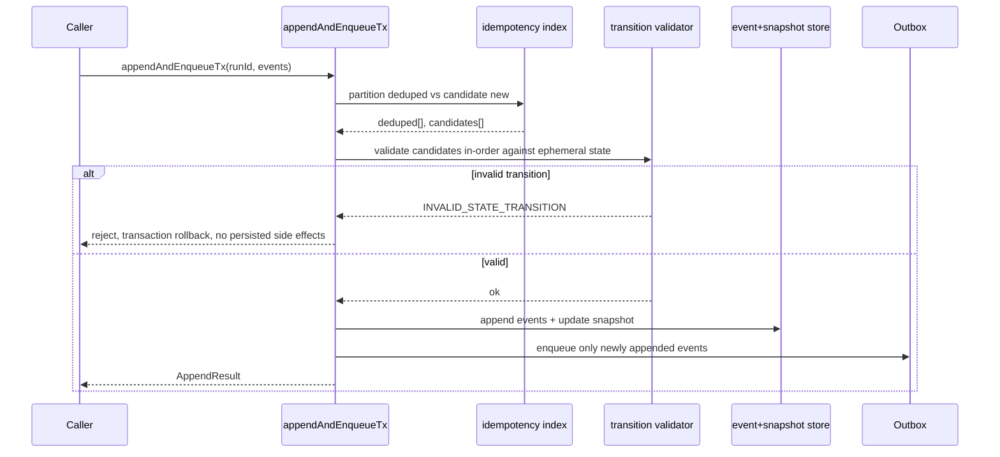

# Run-status write-boundary technical manual

## Purpose

Define the canonical transition rules enforced at event append boundary so
invalid sequences are rejected without persisted side effects (transaction
rollback).

## Scope

Applies to all `appendAndEnqueueTx` implementations:

- `InMemoryRunStateStore`
- `InMemoryTxStore`
- `PostgresRunStateCoordinator` append path (through event repository + snapshot)

## Run-level model

Note: `CANCELLING` is a derived substatus (`cancelling=true`), not a persisted
`WorkflowSnapshot.status` value.

Write-boundary rejection rules:

- `RunPaused` only valid from `RUNNING`.
- `RunResumed` only valid from `PAUSED`.
- `RunCancelled` only valid when run is in cancellation-intent state.
- terminal states (`COMPLETED`, `FAILED`, `CANCELLED`) reject mutating events.

### Signal pre-check guard

For signal-derived lifecycle events (`PAUSE`/`RESUME`), runtime performs a
transition pre-check against current snapshot/event history before calling the
provider adapter signal endpoint. This prevents external side effects when the
transition is already illegal (`INVALID_STATE_TRANSITION` fail-fast).

## Step-attempt model

Write-boundary rejection rules:

- `StepCompleted` only valid from `RUNNING`.
- `StepFailed` only valid from `RUNNING`.
- `StepSkipped` only valid from `PENDING`.
- terminal step states (`COMPLETED`, `SKIPPED`) reject subsequent step events.

## Append pipeline

## TDD strategy

1. add red tests for illegal transitions in `@dvt/run-domain`.
2. add red tests in in-memory store append invariants.
3. add red integration tests in adapter-postgres append path.
4. implement minimal logic to pass all red tests.
5. keep regression coverage for dedupe replay behavior.

## Run-status write-boundary user manual

### Who this is for

Operators and integrators consuming run lifecycle APIs and troubleshooting
transition failures.

### What changes with AR-B1

The system now rejects invalid lifecycle sequences at write time.

Before:

- some invalid sequences could be discovered later during projection.

After:

- invalid sequences fail immediately with `INVALID_STATE_TRANSITION`.
- for `PAUSE`/`RESUME` signals, transition legality is checked before provider
  signal dispatch, so invalid requests are rejected without external side
  effects.

### Typical rejection cases

- `StepCompleted` sent before `StepStarted`.
- `StepFailed` sent while step is still `PENDING`.
- `RunPaused` sent when run is not `RUNNING`.
- `RunResumed` sent when run is not `PAUSED`.
- `RunCancelled` sent without cancellation-intent state.

### Operational behavior on rejection

- no new event is persisted for rejected transition.
- snapshot state is unchanged.
- outbox is not enqueued for rejected event.
- caller receives typed error details to fix producer ordering.

### Recommended response playbook

1. inspect event producer ordering and idempotency key generation.
2. replay corrected events in legal order.
3. verify run timeline through `listEvents` and `getSnapshot`.

### Error shape

`INVALID_STATE_TRANSITION` includes stable context:

- `runId`
- `eventType`
- `fromStatus`
- optional `stepId`

Use those fields for dashboards, alerts, and support triage.

> Section status: Draft. Owner: API / Runtime / Docs. Colocation does not merge component responsibilities.
