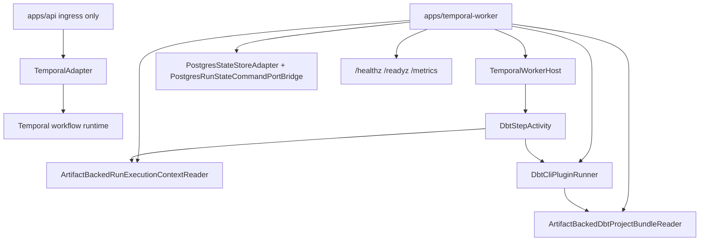
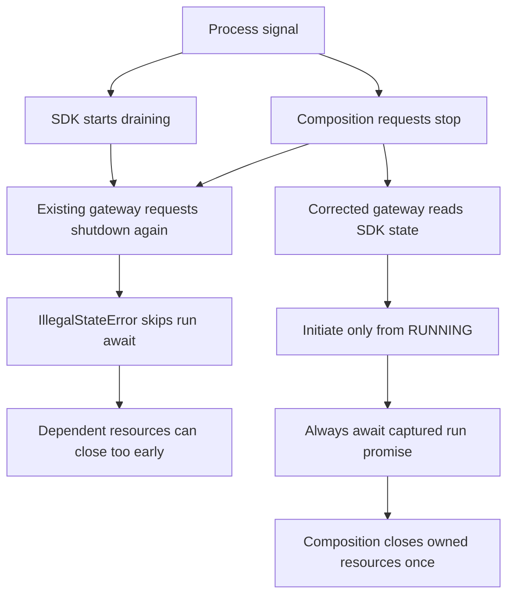
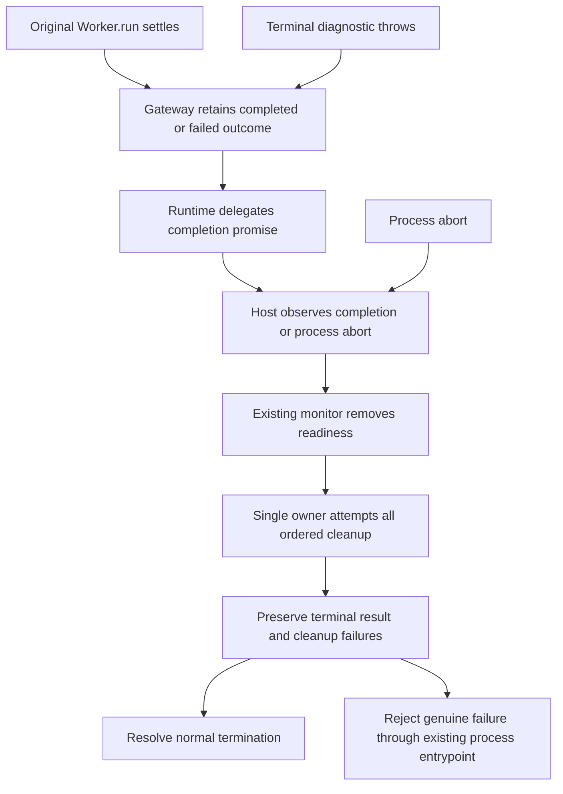
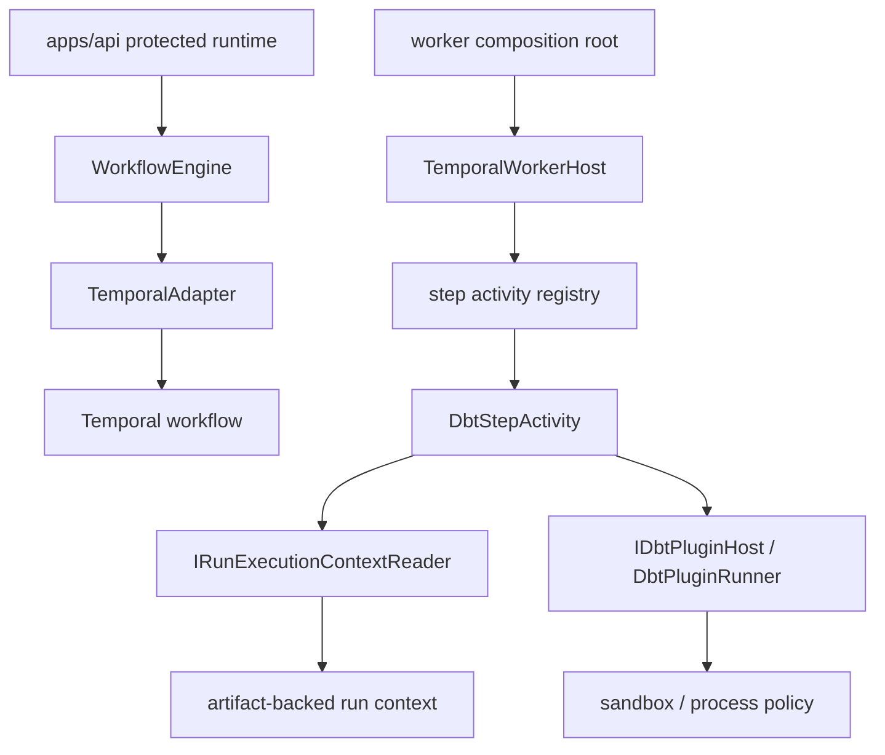
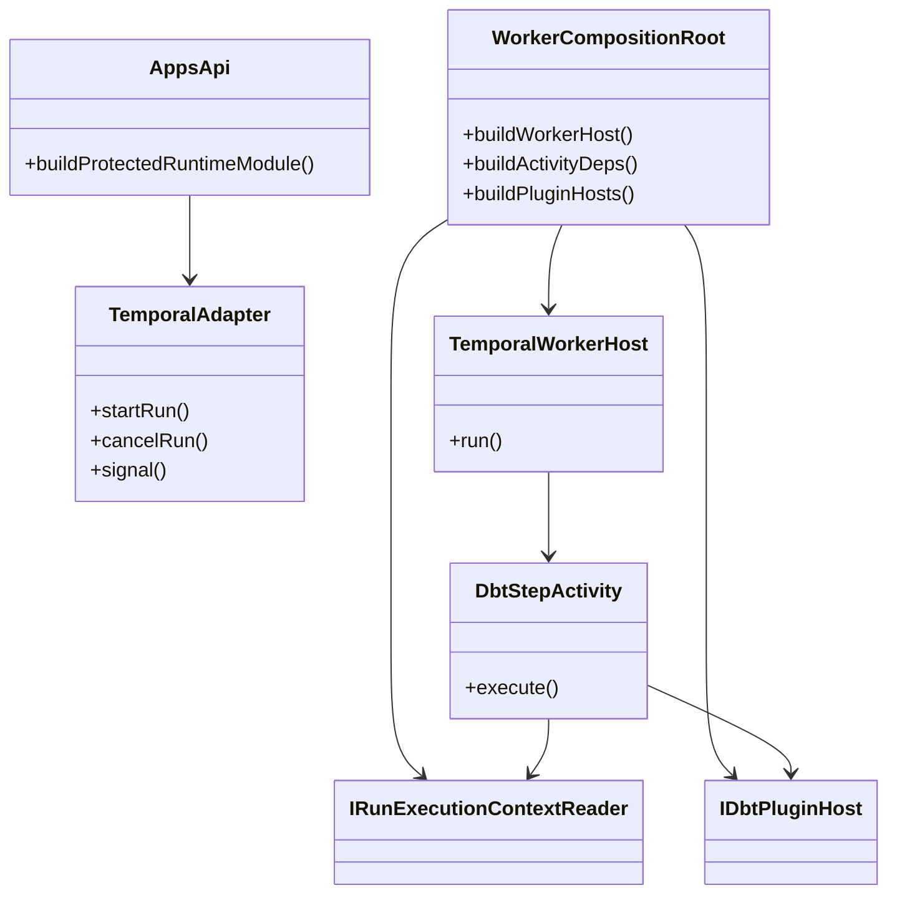

# TF-C3 Production Plugin Host Composition Plan 2026-04-14

## Purpose

Define and track the production composition model for phase-2 dbt execution.

`TF-C3` already landed two useful slices:

1. protected runtime resolves a governed `runExecutionContextRef`; and
2. `@dvt/adapter-temporal` exposes a fail-closed DBT projection seam at the
   adapter boundary.

At planning time, what was missing was the real product composition root that
wired those pieces into a production Temporal worker path without leaking dbt
semantics into `@dvt/engine` or inventing a second product loop.

The core implementation from this plan is now landed in-repo. This document
remains the rationale and decomposition reference for `TF-C3-B..TF-C3-E`.

## Implementation Status

### Landed on 2026-04-14

- `TF-C3-B` reader convergence in `@dvt/artifacts`
- `TF-C3-C` canonical `apps/temporal-worker` composition root
- `TF-C3-D` adapter-owned DBT CLI host behind `DbtPluginRunner`

### Still open

- `TF-C3-E` rollout hardening, acceptance evidence, and operational truth
  beyond the in-repo worker/runbook baseline

### Implemented topology



## Execution Breakdown

| Task      | Intent                                                                               | Effort | Current status |
| --------- | ------------------------------------------------------------------------------------ | ------ | -------------- |
| `TF-C3-B` | converge artifact-backed execution-context and bundle readers under `@dvt/artifacts` | `3pt`  | Landed         |
| `TF-C3-C` | create the canonical standalone Temporal worker composition root                     | `5pt`  | Landed         |
| `TF-C3-D` | run DBT through an adapter-owned CLI host behind `DbtPluginRunner`                   | `8pt`  | Landed         |
| `TF-C3-E` | rollout/runbook/acceptance hardening and truth-surface closure                       | `3pt`  | In progress    |

## Generic Worker Lifecycle

`TF-C3-C` owns the process lifetime of the standalone worker independently of
its configured step plugins. `StopTemporalWorkerRuntime` names the existing
operational command implemented by `RuntimeHandle.stop(): Promise<void>`.
Recording that existing command does not assert that every shutdown defect is
fixed; [#3591](https://github.com/dunay2/dvt/issues/3591) owns the drain correction
and its acceptance evidence.

| Catalog field           | Contract                                                                                                            |
| ----------------------- | ------------------------------------------------------------------------------------------------------------------- |
| Type and owner          | Command; Temporal worker runtime composition; `RuntimeHandle` lifecycle policy                                      |
| Intent and input        | Stop this process-owned runtime instance; no caller-selected tenant, run or resource target                         |
| Application port        | `RuntimeHandle.stop(): Promise<void>`                                                                               |
| Inbound adapter         | Process signal to `AbortSignal` to `runTemporalWorkerHost`                                                          |
| Outbound boundary       | `TemporalWorkerHost.shutdown()` owns the Temporal SDK transition and run completion                                 |
| Output                  | Completion of owned cleanup, or a genuine shutdown/cleanup failure                                                  |
| Scope and authorization | Process-owner operational control over resources created by this runtime; no new HTTP route or tenant authorization |
| Concurrency             | Existing `stopPromise` coalesces repeated runtime stop requests                                                     |
| Ordering                | Startup settles, worker run completes, then connection, state store, artifact reader and step resources close       |
| Negative evidence       | Already-draining and finalizing worker, concurrent stop, never-started host, genuine run/shutdown/cleanup failures  |

### Drain Authority And Error Policy

The SDK and the process composition can both receive the same shutdown signal.
The gateway must distinguish requesting shutdown from joining an already
requested shutdown. The SDK gateway calls `Worker.shutdown()` only when
`Worker.getState()` is `RUNNING`, with no asynchronous gap between those calls.
It then waits for the captured `run()` promise in every SDK state. In particular,
`STOPPED` or `FAILED` is not proof that native finalization and workflow-runtime
destruction have completed. Dependent resources belong to the composition and
cannot close before that run promise settles.

The signal adapter does not interpret SDK states. The existing runtime handle
continues to coalesce stop; there is no second shutdown coordinator and no
global override of SDK shutdown signals.

The existing adapter error contract is preserved: failed runs are logged and
counted, without a successful `run_exit` metric. This drain correction does not
introduce a new rejection contract for those already-recorded run failures.
Genuine synchronous shutdown and resource-cleanup failures remain failures;
message matching, silent catches and fabricated success are not recovery.

The failure corrected by #3591 and its retained ownership boundary:



### Bounded Fowler And Validation Matrix

| scenario                                      | opportunity                            | Fowler pattern                                        | DDD owner                      | command/query rail          | implementation surfaces                        | unit or package test                                                                                                     | architecture test                                              | user-flow test                                                                                      | out of scope                                                          |
| --------------------------------------------- | -------------------------------------- | ----------------------------------------------------- | ------------------------------ | --------------------------- | ---------------------------------------------- | ------------------------------------------------------------------------------------------------------------------------ | -------------------------------------------------------------- | --------------------------------------------------------------------------------------------------- | --------------------------------------------------------------------- |
| SDK has already begun shutdown                | Boundary drift and duplicate semantics | Gateway; separate shutdown initiation from completion | Temporal SDK gateway           | `StopTemporalWorkerRuntime` | `TemporalWorkerHost.ts` and its lifecycle test | RUNNING initiates; STOPPING/DRAINING/DRAINED/STOPPED/FAILED wait for run without another request; preserve error metrics | Existing runtime SRP guard keeps SDK decisions in the adapter  | Existing composed worker lifecycle with an actual signal                                            | Global SDK signal configuration; readiness policy; workload execution |
| Owned resources depend on the draining worker | Test-only confidence                   | Composition Root; explicit resource ownership         | RuntimeHandle lifecycle policy | `StopTemporalWorkerRuntime` | Existing runtime and host tests                | Deferred run blocks closers; repeated runtime stop closes once in order; genuine failures remain visible                 | Existing runtime SRP guard and semantic composition assertions | Existing host/integration proof observes drain and resource release, not only process disappearance | New browser journey, retry policy, shutdown framework                 |

### Terminal Outcome And Startup Failure Contract

[#3694](https://github.com/dunay2/dvt/issues/3694) is implementing the
[admitted termination design](https://github.com/dunay2/dvt/issues/3694#issuecomment-6279831471)
under Planning DB design `GH-3694-TEMPORAL-TERMINATION`. The contract below
defines that implementation; it does not claim passing regression tests or
completed integration. The #3591 drain boundary remains required.

The current gap is a lost result across the gateway: the adapter records an SDK
run failure and clears its active state, while the process host waits only for
an abort signal. The existing monitor consequently receives no failure and can
keep reporting readiness. Separately, early startup-abort returns from the
host's outer `try` execute cleanup but bypass its error-propagation epilogue.

The adapter owns one retained terminal outcome from the original `Worker.run()`:

```ts
type TemporalWorkerRunResult =
  | { readonly status: 'completed' }
  | {
      readonly status: 'failed';
      readonly error: unknown;
      readonly diagnosticError?: unknown;
    };

getRunCompletion(): Promise<TemporalWorkerRunResult> | null;
```

The promise fulfills with the SDK outcome after native run finalization. A
failed result retains the original error; it is not successful completion.
Clearing the active worker must not erase that result. `null` means no SDK run
was started, and successful runtime startup with a null completion is an
invariant failure. The required runtime port delegates this same promise; it
does not synthesize pending work, add a callback channel, poll SDK state, or
maintain a second state machine.

Terminal diagnostics are fallible dependencies. If recording the SDK failure
throws, completion must still fulfill with the original SDK error by identity
and an additional `diagnosticError`. Property presence records that diagnostic
failure even when its thrown value is `undefined` or `null`; consumers must not
test its truthiness. The host reports both values with `AggregateError` in
SDK-then-diagnostic order, applying its existing process-boundary normalization
to unknown values. Neither failure may replace or silently hide the other, and
the adapter must not retry through the failed diagnostic sink. The completed
outcome and shutdown drain contract are unchanged.

The process host observes the terminal outcome alongside process abort. A
normal SDK completion ends the host normally even when it precedes the
application's signal handler. A failed outcome removes readiness through the
existing monitor and becomes the primary process failure. If abort wins the
race, the host still preserves any failed run outcome that settles during
cleanup. The error's name alone, including `AbortError`, cannot turn a fatal SDK
outcome into expected startup cancellation.

One outer cleanup owner attempts runtime stop and operational-server stop, then
propagates primary and cleanup failures. Every startup-abort checkpoint must
reach that epilogue. The adapter's existing shutdown contract remains: it joins
the run and does not report an already-recorded run failure again as a cleanup
failure. Genuine shutdown and cleanup failures still reject. The host removes
the losing abort listener when SDK completion ends its wait.

Startup and stop use the existing runtime handle. Once `stopPromise` exists,
`start()` rejects before its already-started shortcut, including stop-before-start,
stop in progress, and successful or failed stop. An already-admitted start may
settle before the existing stop owner drains it; concurrent admitted starts
continue to share `startPromise`. This is a handle admission invariant, not a
new restart coordinator.

| Rail                                         | Existing owner and port                                                       | Required boundary                                                                                            |
| -------------------------------------------- | ----------------------------------------------------------------------------- | ------------------------------------------------------------------------------------------------------------ |
| `StartTemporalWorkerRuntime`                 | RuntimeHandle lifecycle policy; `RuntimeHandle.start(signal?)`                | Catalog the existing startup intent; reject startup after stop begins and preserve real startup failures     |
| `StopTemporalWorkerRuntime`                  | RuntimeHandle lifecycle policy; `RuntimeHandle.stop()`                        | Retain drain ordering and propagate real cleanup failures through every startup-abort path                   |
| `DescribeTemporalWorkerOperationalReadiness` | `TemporalWorkerOperationalReadModel`; existing monitor snapshot and `/readyz` | Reflect worker termination through the existing projection; add no route, topology model or capability facts |

All three retain process-owner scope over this runtime instance. The completion
getter is an internal observation port supporting these rails, not another
catalog intent. The existing server entrypoint already exits unsuccessfully
when the process host rejects; the monitor and HTTP serialization need no new
states or failure channel.



The Fowler rationale is to expose the result at its owning Gateway and keep
process policy at the Composition Root. Extracting the startup/wait control
flow removes the premature-return path without introducing another cleanup
service. An explicit discriminated result avoids both an unobserved rejecting
background promise and external callback exception semantics.
The same gateway retains diagnostic transport failure as additional evidence;
it does not change the native outcome or create another observation owner.

| scenario                                          | opportunity                          | Fowler pattern                             | DDD owner                     | command/query rail                                                    | implementation surfaces                                 | unit or package test                                                                                             | architecture test                                           | user-flow test                                              | out of scope                                   |
| ------------------------------------------------- | ------------------------------------ | ------------------------------------------ | ----------------------------- | --------------------------------------------------------------------- | ------------------------------------------------------- | ---------------------------------------------------------------------------------------------------------------- | ----------------------------------------------------------- | ----------------------------------------------------------- | ---------------------------------------------- |
| Worker ends while the process still appears ready | Boundary drift; lost result          | Gateway; explicit result; Composition Root | SDK gateway and RuntimeHandle | StopTemporalWorkerRuntime; DescribeTemporalWorkerOperationalReadiness | Adapter host/export, runtime ports/handle, process host | Immediate failure, late observation, normal completion and abort/fatal race                                      | Existing runtime SRP guard and direct completion delegation | Existing composed host with actual SDK and operational HTTP | Boot UI, topology, capacity, retry policy      |
| Recording a terminal failure also throws          | Diagnostic dependency can mask cause | Gateway; explicit result                   | SDK gateway and process host  | StopTemporalWorkerRuntime; DescribeTemporalWorkerOperationalReadiness | Existing adapter host and process host                  | Logger/counter throw, unknown diagnostic values, retained SDK identity, no orphan rejection, ordered aggregation | Same completion delegation and cleanup ownership guards     | Same real SDK termination boundary                          | Observability package changes, retry framework |
| Startup abort loses cleanup failure               | Control flow bypasses failure policy | Extract Function; one cleanup owner        | Process host lifecycle policy | StartTemporalWorkerRuntime; StopTemporalWorkerRuntime                 | Existing process host                                   | Each startup-abort checkpoint, runtime/server cleanup failures, primary plus cleanup aggregation                 | Existing lifecycle ownership guard                          | Existing host test with operational server                  | New cleanup framework, plugin changes          |
| Startup follows terminal stop                     | Invalid lifecycle admission          | Enforce invariant at existing boundary     | RuntimeHandle                 | StartTemporalWorkerRuntime                                            | Existing runtime handle                                 | Stop-before-start, stopping and successful/failed stop; concurrent start                                         | Existing runtime SRP guard                                  | Same composed host proof                                    | Generic restart support, another state machine |

The real-provider failure proof must preserve the original SDK run and state
transitions. A forced-shutdown fixture, if used, must identify the SDK timeout
policy and its teardown limits; a fabricated rejected `Worker.run()` promise is
only unit evidence. The existing successful Linux SIGTERM canary remains the
regression proof for normal SDK signal ordering. Required RED/GREEN and native
results belong in the issue and admitted evidence after execution.

Validation starts with these exact files, using `pnpm --filter <package> exec
vitest run <file>` and the existing package configuration. Real Temporal
integration must run its canonical runtime dependency preparation before the
selected test. Broad browser suites are not evidence for this SDK transition.
Required ARC artifacts and repository gates still apply to the complete diff.

## Feature Mechanization

```feature-mechanization
version: 1
featureId: TF-C3-E-TEMPORAL-WORKER-RUNBOOK-TRUTH
mechanizationStatus: implemented
noHumanDecisionsRemaining: true
implementationPlan: docs/planning/proposals/mandatory/runtime-and-contracts/tf-c3-production-plugin-host-composition-plan-20260414.md
componentGuides:
  - docs/architecture/components/engine/adapters/temporal/temporal-dbt-worker-plugin-profile.md
  - docs/runbooks/temporal-worker-dbt-plugin-runtime-20260414.md
userStories:
  - docs/planning/proposals/mandatory/runtime-and-contracts/tf-c3-production-plugin-host-composition-plan-20260414.md
governingSources:
  - AGENTS.md
  - docs/planning/status/governance-document-rule-inventory.md
  - docs/guides/ai-work-protocol.md
  - docs/architecture/command-query-rail-governance.md
  - docs/architecture/fowler-opportunity-planning-governance.md
  - docs/architecture/components/api/protected-runtime-command-query-rail-design.md
  - docs/planning/proposals/mandatory/runtime-and-contracts/ar-c3-start-run-execution-capacity-admission-plan-20260422.md
  - docs/architecture/components/engine/adapters/temporal/temporal-dbt-worker-plugin-profile.md
allowedImplementationSurfaces:
  - docs/planning/proposals/mandatory/runtime-and-contracts/tf-c3-production-plugin-host-composition-plan-20260414.md
  - docs/runbooks/temporal-worker-dbt-plugin-runtime-20260414.md
  - docs/runbooks/temporal-worker-scaling-operations.md
  - docs/architecture/components/engine/adapters/temporal/temporal-worker-scaling-strategy.md
  - docs/planning/closeouts/**
  - docs/planning/roadmap/strategic-product-roadmap.md
  - docs/planning/roadmap/roadmap-by-domain.md
  - apps/temporal-worker/package.json
  - apps/temporal-worker/test/host/runTemporalWorkerHost.test.ts
  - docs/.manifest.json
  - docs/planning/status/**
forbiddenImplementationSurfaces:
  - apps/api/**
  - apps/lineage-worker/**
  - apps/outbox-worker/**
  - apps/projector-worker/**
  - apps/web/**
  - packages/**
  - specs/**
  - .github/**
  - scripts/**
  - tools/**
commandQueryRails:
  - name: DescribeTemporalWorkerOperationalReadiness
    type: query
    dddOwner: TemporalWorkerOperationalReadModel
  - name: UpdateTfC3RolloutTruth
    type: command
    dddOwner: TfC3RolloutTruth
domainObjects:
  - name: TemporalWorkerOperationalReadModel
    type: operational read model
    owner: Runtime / SRE / Delivery
  - name: TfC3RolloutTruth
    type: planning aggregate
    owner: Runtime / SRE / Delivery / Docs
fowlerSignals:
  - Documentation drift
  - Test-only confidence prevention
architectureGuards:
  - pnpm docs:feature-mechanization --feature TF-C3-E-TEMPORAL-WORKER-RUNBOOK-TRUTH
  - pnpm docs:feature-mechanization:implementation
cypressFlows:
  - N/A - operational runbook and planning truth only
completionGate:
  - pnpm governance:refresh
  - pnpm docs:gov:links:changed
  - pnpm verify:prepush
redGreenCycles:
  - id: tf-c3-e-runbook-truth
    redTest: pnpm docs:feature-mechanization:implementation
    expectedFailure: >
      Temporal worker DBT runbook changes are outside
      allowedImplementationSurfaces before this manifest declares TF-C3-E
      runbook truth.
    patchSurfaces:
      - docs/planning/proposals/mandatory/runtime-and-contracts/tf-c3-production-plugin-host-composition-plan-20260414.md
      - docs/runbooks/temporal-worker-dbt-plugin-runtime-20260414.md
    greenTest: pnpm docs:feature-mechanization:implementation
  - id: tf-c3-e-docker-canary
    redTest: pnpm --filter dvt-temporal-worker test -- test/host/runTemporalWorkerHost.test.ts
    expectedFailure: >
      A DBT-enabled Temporal worker can report healthy while the real workflow
      path is not proven against Postgres, Temporal test service, plan-store
      artifacts, run metadata, readiness, metrics, and DBT invocation evidence.
    patchSurfaces:
      - apps/temporal-worker/package.json
      - apps/temporal-worker/test/host/runTemporalWorkerHost.test.ts
      - docs/runbooks/temporal-worker-dbt-plugin-runtime-20260414.md
    greenTest: >
      DVT_PG_INTEGRATION=1 pnpm --filter dvt-temporal-worker test --
      test/host/runTemporalWorkerHost.test.ts
symbols:
  - name: TfC3ProductionPluginHostCompositionPlan
    path: docs/planning/proposals/mandatory/runtime-and-contracts/tf-c3-production-plugin-host-composition-plan-20260414.md
    dddOwner: TfC3RolloutTruth
    cqRails:
      - UpdateTfC3RolloutTruth
    fowlerSignals:
      - Documentation drift
    architectureGuard: pnpm docs:feature-mechanization:implementation
    cypressCoverage: N/A - planning proposal only
    unitTests:
      - pnpm docs:feature-mechanization --feature TF-C3-E-TEMPORAL-WORKER-RUNBOOK-TRUTH
      - pnpm docs:feature-mechanization:implementation
  - name: TemporalWorkerDbtRuntimeRunbook
    path: docs/runbooks/temporal-worker-dbt-plugin-runtime-20260414.md
    dddOwner: TemporalWorkerOperationalReadModel
    cqRails:
      - DescribeTemporalWorkerOperationalReadiness
    fowlerSignals:
      - Documentation drift
      - Test-only confidence prevention
    architectureGuard: pnpm docs:feature-mechanization:implementation
    cypressCoverage: N/A - operational runbook only
    unitTests:
      - pnpm docs:gov:links:changed
      - pnpm lint:md:changed
  - name: describeIfPg
    path: apps/temporal-worker/test/host/runTemporalWorkerHost.test.ts
    dddOwner: TemporalWorkerOperationalReadModel
    cqRails:
      - DescribeTemporalWorkerOperationalReadiness
    fowlerSignals:
      - Test-only confidence prevention
    architectureGuard: pnpm docs:feature-mechanization:implementation
    cypressCoverage: N/A - worker canary test
    unitTests:
      - pnpm --filter dvt-temporal-worker test -- test/host/runTemporalWorkerHost.test.ts
  - name: waitForAsync
    path: apps/temporal-worker/test/host/runTemporalWorkerHost.test.ts
    dddOwner: TemporalWorkerOperationalReadModel
    cqRails:
      - DescribeTemporalWorkerOperationalReadiness
    fowlerSignals:
      - Test-only confidence prevention
    architectureGuard: pnpm docs:feature-mechanization:implementation
    cypressCoverage: N/A - worker canary test
    unitTests:
      - pnpm --filter dvt-temporal-worker test -- test/host/runTemporalWorkerHost.test.ts
  - name: createDbtProjectBundle
    path: apps/temporal-worker/test/host/runTemporalWorkerHost.test.ts
    dddOwner: TemporalWorkerOperationalReadModel
    cqRails:
      - DescribeTemporalWorkerOperationalReadiness
    fowlerSignals:
      - Test-only confidence prevention
    architectureGuard: pnpm docs:feature-mechanization:implementation
    cypressCoverage: N/A - worker canary test
    unitTests:
      - pnpm --filter dvt-temporal-worker test -- test/host/runTemporalWorkerHost.test.ts
  - name: storeValidPlanArtifact
    path: apps/temporal-worker/test/host/runTemporalWorkerHost.test.ts
    dddOwner: TemporalWorkerOperationalReadModel
    cqRails:
      - DescribeTemporalWorkerOperationalReadiness
    fowlerSignals:
      - Test-only confidence prevention
    architectureGuard: pnpm docs:feature-mechanization:implementation
    cypressCoverage: N/A - worker canary test
    unitTests:
      - pnpm --filter dvt-temporal-worker test -- test/host/runTemporalWorkerHost.test.ts
  - name: createDbtExecutionPlan
    path: apps/temporal-worker/test/host/runTemporalWorkerHost.test.ts
    dddOwner: TemporalWorkerOperationalReadModel
    cqRails:
      - DescribeTemporalWorkerOperationalReadiness
    fowlerSignals:
      - Test-only confidence prevention
    architectureGuard: pnpm docs:feature-mechanization:implementation
    cypressCoverage: N/A - worker canary test
    unitTests:
      - pnpm --filter dvt-temporal-worker test -- test/host/runTemporalWorkerHost.test.ts
  - name: bootstrapRunMetadata
    path: apps/temporal-worker/test/host/runTemporalWorkerHost.test.ts
    dddOwner: TemporalWorkerOperationalReadModel
    cqRails:
      - DescribeTemporalWorkerOperationalReadiness
    fowlerSignals:
      - Test-only confidence prevention
    architectureGuard: pnpm docs:feature-mechanization:implementation
    cypressCoverage: N/A - worker canary test
    unitTests:
      - pnpm --filter dvt-temporal-worker test -- test/host/runTemporalWorkerHost.test.ts
  - name: waitForRunCompleted
    path: apps/temporal-worker/test/host/runTemporalWorkerHost.test.ts
    dddOwner: TemporalWorkerOperationalReadModel
    cqRails:
      - DescribeTemporalWorkerOperationalReadiness
    fowlerSignals:
      - Test-only confidence prevention
    architectureGuard: pnpm docs:feature-mechanization:implementation
    cypressCoverage: N/A - worker canary test
    unitTests:
      - pnpm --filter dvt-temporal-worker test -- test/host/runTemporalWorkerHost.test.ts
  - name: getOperationalJson
    path: apps/temporal-worker/test/host/runTemporalWorkerHost.test.ts
    dddOwner: TemporalWorkerOperationalReadModel
    cqRails:
      - DescribeTemporalWorkerOperationalReadiness
    fowlerSignals:
      - Test-only confidence prevention
    architectureGuard: pnpm docs:feature-mechanization:implementation
    cypressCoverage: N/A - worker canary test
    unitTests:
      - pnpm --filter dvt-temporal-worker test -- test/host/runTemporalWorkerHost.test.ts
  - name: getOperationalText
    path: apps/temporal-worker/test/host/runTemporalWorkerHost.test.ts
    dddOwner: TemporalWorkerOperationalReadModel
    cqRails:
      - DescribeTemporalWorkerOperationalReadiness
    fowlerSignals:
      - Test-only confidence prevention
    architectureGuard: pnpm docs:feature-mechanization:implementation
    cypressCoverage: N/A - worker canary test
    unitTests:
      - pnpm --filter dvt-temporal-worker test -- test/host/runTemporalWorkerHost.test.ts
  - name: metricValue
    path: apps/temporal-worker/test/host/runTemporalWorkerHost.test.ts
    dddOwner: TemporalWorkerOperationalReadModel
    cqRails:
      - DescribeTemporalWorkerOperationalReadiness
    fowlerSignals:
      - Test-only confidence prevention
    architectureGuard: pnpm docs:feature-mechanization:implementation
    cypressCoverage: N/A - worker canary test
    unitTests:
      - pnpm --filter dvt-temporal-worker test -- test/host/runTemporalWorkerHost.test.ts
  - name: sha256Hex
    path: apps/temporal-worker/test/host/runTemporalWorkerHost.test.ts
    dddOwner: TemporalWorkerOperationalReadModel
    cqRails:
      - DescribeTemporalWorkerOperationalReadiness
    fowlerSignals:
      - Test-only confidence prevention
    architectureGuard: pnpm docs:feature-mechanization:implementation
    cypressCoverage: N/A - worker canary test
    unitTests:
      - pnpm --filter dvt-temporal-worker test -- test/host/runTemporalWorkerHost.test.ts
```

## Governing sources

- [AGENTS.md](../../../../../AGENTS.md)
- [AI Work Protocol](../../../../guides/ai-work-protocol.md)
- [DVT+ Execution Model Specification](../../../execution-model/dvt-execution-model.md)
- [IProviderAdapter Contract](../../../../architecture/components/engine/contracts/engine/IProviderAdapter.v1.md)
- [Plugin Sandbox Contract](../../../../architecture/components/engine/contracts/extensions/PluginSandbox.v1.md)
- [Execution Runtime domain](../../../domains/execution-runtime.md)
- [System Delivery Status](../../../../architecture/system-delivery-status.md)

## Historical provenance

These inputs explain earlier implementation decisions; they are not current
governing sources. Current contracts and the authorities above remain in force.

- [Transformation Flow Product Decisions 2026-04-05](https://github.com/dunay2/dvt/blob/6dab0fe76db1fac675744b9b1dbe3af1ad8f1de1/docs/planning/proposals/mandatory/runtime-and-contracts/transformation-flow-product-decisions-20260405.md)

## Think-First Analysis

### Original problem summary

The repo no longer lies about DBT being a kernel feature. That part was fixed
before this plan was implemented.

At plan time, the system still did not have a real in-repo production
composition path that injected:

- `IRunExecutionContextReader`; and
- an adapter-owned `DbtPluginRunner`

into the actual Temporal worker that executes `DbtStepActivity`.

That left the system in this posture:

- admission boundary: materially real
- adapter seam: materially real
- production worker composition: undefined

That was not a bug at one line. It was a missing composition model.

### Original root cause

The repository had a clean engine-to-adapter boundary, but not yet a clean
host-runtime boundary for extension execution.

More concretely:

- `apps/api` composes provider adapters for the protected runtime ingress
  surface;
- `@dvt/adapter-temporal` contains `TemporalAdapter`, `TemporalWorkerHost`,
  step-activity factories, and the DBT projection seam; but
- there was no canonical in-repo worker bootstrap that said where the DBT host
  runtime is built, how it receives artifacts/runtime readers, and how the
  worker lifecycle is owned operationally.

That gap was previously hidden by tests and by a tendency to treat
`TemporalWorkerHost` as an implementation detail instead of a first-class
composition boundary.

### Pre-implementation current-state model


### Why this mattered

Without a production composition model, the system was vulnerable to four bad
outcomes:

1. DBT runtime stays test-only.
2. Somebody wires DBT by reaching upward into kernel or API code.
3. A later bootstrap path injects the seam incorrectly and drifts from tests.
4. A second product loop appears because the missing host gets solved ad hoc.

### Constraints and invariants

- `dbt` must remain outside `@dvt/engine` semantics.
- `IProviderAdapter` remains the engine-facing runtime boundary.
- plugin runtime inputs must be explicit and deny-by-default.
- `RunExecutionContext` remains the immutable execution payload carrier.
- `TF-C3` must reuse the same outer loop:
  `design -> preview -> PlanRef -> run -> result`.
- one persisted plan still binds one provider/executor profile for that run.
- production composition must be explicit about process ownership, bootstrap,
  health, and failure mode.

### Options considered

#### Option A. Inject DBT runtime directly from `apps/api`

Have `apps/api` own the DBT runner and hand it downward into Temporal worker
internals.

**Why it is attractive**

- fewer moving parts at first glance
- no extra process/bootstrap artifact required immediately

**Why it is wrong**

- collapses ingress composition and worker composition into one place
- increases pressure to let API own provider runtime semantics
- does not model a mature worker-host boundary
- invites hidden coupling between HTTP startup and execution worker lifecycle

#### Option B. Push DBT semantics into `@dvt/engine`

Treat DBT mode as an engine concern and let the engine decide plugin behavior.

**Why it is attractive**

- one central place to reason about execution
- may appear to reduce host complexity

**Why it is wrong**

- directly violates the existing execution model and phase-2 product decisions
- turns provider/executor specifics into kernel semantics
- makes future provider growth harder, not easier

#### Option C. Define a dedicated worker composition root that owns plugin host wiring

Create a canonical worker-bootstrap boundary that:

- constructs `TemporalWorkerHost`;
- injects `IRunExecutionContextReader`;
- injects adapter-owned plugin runners such as DBT; and
- keeps runtime/process ownership outside engine core and HTTP ingress.

**Why it is attractive**

- matches the repo's hexagonal stance
- preserves the existing seam instead of bypassing it
- gives one place for operational ownership, health, rollout flags, and future
  sandbox policy
- copies a mature systems posture: explicit worker composition root, explicit
  plugin/runtime host, explicit process boundary

**Why it is not free**

- adds one more top-level composition concern
- forces clarity on worker lifecycle and deployment shape
- needs docs and operational truth before code

### Selected option and rationale

Select **Option C**.

The missing problem is not "how do we call DBT from a step activity". That part
already exists as a seam.

The missing problem is "where does the real worker runtime get composed, owned,
and operated".

That is a composition-root problem. Mature systems solve it with an explicit
runtime host boundary, not by smearing provider logic across HTTP startup,
engine core, and tests.

### Rejected alternatives

- API-owned DBT host injection: rejected because it collapses ingress and
  worker responsibilities.
- Engine-owned DBT behavior: rejected because it violates the provider/plugin
  boundary.
- [Task: RUNTIME-PROP-DISP-1] "Just keep the seam and wire later": rejected because it is not a design; it
  is deferred ambiguity.

## Fowler-style System Model

### Primary separation

The model needs four layers, each with one job:

| Layer                     | Responsibility                                     | Must not own               |
| ------------------------- | -------------------------------------------------- | -------------------------- |
| Product ingress           | admit, authorize, persist, start by `PlanRef`      | worker runtime lifecycle   |
| Engine + provider adapter | execution policy plus provider dispatch boundary   | plugin-host process policy |
| Worker composition root   | construct worker host and runtime dependencies     | HTTP/API concerns          |
| Plugin host               | execute DBT-specific runtime behavior under policy | canonical run truth        |

### Target-state model



### Responsibility model



## Benchmark posture from mature systems

This is not about cloning one product. It is about borrowing the right shape.

| Mature posture                          | What to copy                                                         | What not to copy                                        |
| --------------------------------------- | -------------------------------------------------------------------- | ------------------------------------------------------- |
| Temporal-style worker model             | explicit worker bootstrap and lifecycle outside request-serving code | letting workflow SDK concerns define product boundaries |
| Dagster-style code location separation  | user/runtime execution lives behind an explicit host boundary        | broad asset-platform scope                              |
| Airbyte-style worker/process separation | connectors/executors run behind dedicated worker ownership           | connector sprawl and platform breadth                   |
| dbt-style artifact reviewability        | Git-first and artifact-first runtime inputs                          | making dbt project management the product surface       |

The common theme is the same:

- core orchestration stays small;
- execution hosts are explicit;
- plugin/connector code runs behind a dedicated boundary;
- operational lifecycle is owned by the host, not by the kernel.

## Proposed production composition model

### 1. Add a canonical worker composition root

Introduce an explicit in-repo composition root for Temporal worker startup.

It should own:

- worker config
- `TemporalWorkerHost` construction
- activity dependency construction
- `IRunExecutionContextReader` wiring
- plugin-host wiring for DBT

It must not own:

- HTTP route setup
- engine lifecycle truth
- UI contracts

### 2. Make DBT host runtime an adapter-owned host interface

Keep DBT-specific runtime behavior behind an adapter-owned host boundary such
as `IDbtPluginHost` or a stricter successor to `DbtPluginRunner`.

That boundary should own:

- invocation shape
- runtime failure mapping
- host-local policy hooks
- future sandbox/process delegation

It must not own:

- canonical run status
- event ordering
- engine retries or business lifecycle policy

### 3. Keep the step activity thin

`DbtStepActivity` should do only:

1. resolve immutable context
2. validate required DBT plugin payload
3. delegate to the plugin host
4. map result/failure back to activity result

It should not:

- bootstrap a host
- discover environment config
- open artifacts itself beyond the reader seam
- own sandbox/process policy

### 4. Treat plugin host policy as host-owned, not kernel-owned

The worker composition root and plugin host should become the place where later
policy lands:

- rollout flags
- sandbox tier
- resource limits
- health/readiness
- plugin runtime observability

That is consistent with `PluginSandbox.v1.md` and avoids retrofitting policy
into step activities.

## Implementation slice model

### Phase 2A. Design and bootstrap closure

Required outputs:

- canonical worker composition plan
- agreed process owner for Temporal worker startup
- explicit dependency model for `IRunExecutionContextReader` and DBT host

Current status:

- Landed through the shared artifact readers, the standalone worker app, and
  the DBT CLI host composition path.

### Phase 2B. Runtime host wiring

Required outputs:

- in-repo production worker bootstrap exists
- DBT host injected through that bootstrap
- fail-closed health behavior when host wiring is absent

Current status:

- Landed in `apps/temporal-worker` with DBT-on startup validation, fail-closed
  reader/runner composition, and dedicated operational endpoints.

### Phase 2C. Operational hardening

Required outputs:

- worker/bootstrap docs and runbook
- rollout and diagnostics surfaces
- tests for host composition, not only adapter seam behavior

Current status:

- Partially landed. The worker now ships `/healthz`, `/readyz`, `/metrics`,
  dedicated monitor/tests, and a runbook baseline. Remaining work is rollout
  evidence and broader environment acceptance, not missing in-repo topology.

## Pre-Implementation Brief

- Mode: Full
- Scope:
  - production Temporal worker composition root
  - adapter-owned plugin host boundary for DBT
  - operational documentation and rollout truth
- Expected outcome:
  - repo contains one truthful place where DBT runtime is composed
  - DBT stays adapter/plugin-owned rather than kernel-owned
  - worker lifecycle and plugin lifecycle become explicit and testable
- Risks and mitigations:
  - Risk: invent a second product loop
  - Mitigation: preserve `PlanRef` start and existing outer contract
  - Risk: push DBT semantics upward into API or engine
  - Mitigation: keep all DBT host logic below `IProviderAdapter`
  - Risk: hide the host in another implicit helper
  - Mitigation: require an explicit top-level composition root and runbook
- Out of scope:
  - marketplace packaging
  - full sandbox implementation
  - broad executor/plugin framework generalization beyond the DBT host seam
- Validation plan:
  - composition-root tests
  - adapter/worker integration proof
  - docs/planning regeneration
  - `pnpm verify:prepush`
- Test coverage plan:
  - worker startup with host wiring present
  - worker startup with host wiring absent
  - DBT step fails closed when host rejects invalid payload
  - DBT step succeeds through composed host path, not fixture-only wiring
- Libraries evaluated:
  - None adopted in this plan slice. The chosen posture borrows system shape
    from mature worker-host designs rather than introducing a new framework.

## Decision rules for implementation

Implementation is acceptable only if all of this stays true:

1. no DBT semantics move into `@dvt/engine`
2. no API route becomes the owner of worker/plugin lifecycle
3. there is one canonical worker composition root in-repo
4. tests cover the production-style composition path, not just helpers
5. planning/docs describe the same topology that code implements

## Not done if

This slice must still be treated as incomplete if any of these remain true:

1. the only DBT wiring path is in tests
2. `DbtStepActivity` can only run with helper-injected deps
3. no canonical worker bootstrap exists in repo
4. host policy is still buried in step activity code
5. docs still imply runtime closure without host composition
