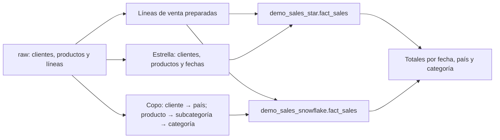

# Demo de ventas en estrella y copo de nieve

La demo parte de PostgreSQL de pruebas `dvt_demo`. El SQL de preparación crea
tres tablas sintéticas `raw.demo_sales_*`. dbt publica dos conjuntos de tablas
en `demo_sales_star` y `demo_sales_snowflake`. Cada fila de hechos corresponde
a una línea de pedido. Las dos salidas usan las mismas cantidades e importes
netos, con el descuento descontado una sola vez en el modelo común.
Las vistas intermedias de `demo_sales_stage` permiten verificar cada paso
al ejecutar el proceso desde DVT.
Para editar los joins en la vista semántica, los modelos exponen claves
enteras de 64 bits, una clave de fecha ISO y el importe neto en céntimos.



## Preparar y ejecutar

1. Ejecuta `setup_raw.sql` con un cliente conectado a `dvt_demo`. La carga
   sintética es transaccional y se puede repetir.
2. Configura `DVT_DEMO_POSTGRES_PASSWORD` con la credencial local existente.
   Desde este directorio ejecuta `dbt build --profiles-dir .`. La demo usa el
   perfil local `code_inline_demo`, también administrado por el entorno DVT.
3. Importa este directorio como proyecto dbt en DVT mediante **Importar proyecto
   dbt**. Usa la conexión de PostgreSQL de pruebas `local-postgres-proof`.
4. Abre `star_fact_sales` y `snowflake_fact_sales` en el Canvas. La vista
   `sales_comparison` permite contrastar los resultados agrupados de ambos.

En el proyecto local **Demo dimensional de ventas**, el Canvas **Estrella y
copo de nieve** contiene los orígenes y las dimensiones, y permite abrir
**Ventas · Estrella** y **Ventas · Copo de nieve** en **Vista semántica**. El
linaje del proyecto dbt muestra cómo se crean las dimensiones y las salidas
desde `raw`. La carga tiene 24 pedidos, 72 líneas, 180 unidades y un importe
neto de 5.541,00 en cada salida. La vista de comparación devuelve 40 grupos
sin diferencias.

## Recrear los modelos del editor semántico

Para cada modelo nativo, importa `demo_sales_stage.staged_sales_lines` y las
dimensiones del esquema correspondiente. Conecta esos orígenes al modelo y
aplica el SQL desde su editor. Los modelos nativos publican
`fact_sales_semantic` en sus respectivos esquemas para poder cambiar y
ejecutar la versión gráfica por separado.

### Estrella

```sql
select
  sales.sales_line_key, sales.order_key, day.day_key as order_date,
  customer.customer_id, customer.region_name, customer.country_name,
  product.product_id, product.category_name, product.subcategory_name,
  sales.units, sales.net_cents
from staged_sales_lines as sales
inner join dim_customer as customer on customer.customer_id = sales.customer_key
inner join dim_product as product on product.product_id = sales.product_key
inner join dim_date as day on day.day_key = sales.day_key
```

### Copo de nieve

```sql
select
  sales.sales_line_key, sales.order_key, day.day_key as order_date,
  customer.customer_id, country.region_name, country.country_name,
  product.product_id, category.category_name, subcategory.subcategory_name,
  sales.units, sales.net_cents
from staged_sales_lines as sales
inner join (
  dim_customer as customer
  inner join dim_country as country on country.country_code = customer.country_code
) on customer.customer_id = sales.customer_key
inner join (
  dim_product as product
  inner join dim_subcategory as subcategory on subcategory.subcategory_id = product.subcategory_id
  inner join dim_category as category on category.category_id = subcategory.category_id
) on product.product_id = sales.product_key
inner join dim_date as day on day.day_key = sales.day_key
```

Las pruebas de dbt comparan los hechos con las líneas de origen, verifican las
relaciones con las dimensiones y comparan los agregados de las dos salidas.
La demo usa dos esquemas de salida dentro de la misma base. Para usar otra base,
la conexión de ejecución de PostgreSQL debe poder leer allí el origen, por
ejemplo mediante una copia de las tres tablas sintéticas.
